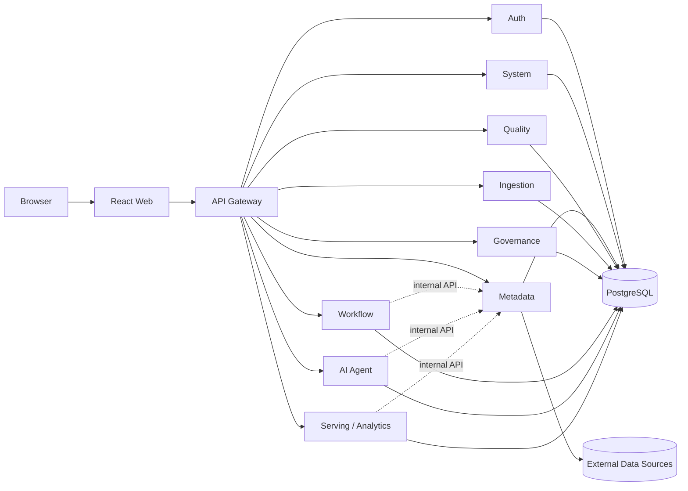

<p align="center">
  
</p>

<h1 align="center">Aetheris</h1>

<p align="center">
  面向数据团队的一体化数据中台，将数据接入、开发、建模、治理、服务、分析与智能问答整合到统一工作空间。
</p>

<p align="center">
  
  
  
  
  
</p>

## 项目概述

Aetheris 采用前后端分离与领域微服务架构。所有业务 API 通过网关统一鉴权，数据源凭据与 JDBC 驱动集中保留在元数据服务中，其他服务通过受控内部接口完成查询与执行。

当前版本已经形成从数据连接、元数据采集、SQL 加工、任务调度，到自然语言数据问答和可视化看板发布的核心闭环。数据接入执行器、质量检测执行器和高级治理策略仍在持续建设。

## 核心能力

| 领域 | 能力 |
| --- | --- |
| 数据接入 | 数据源连接管理、连接测试、库表浏览与接入任务定义 |
| 数据开发 | SQL 加工任务、Quartz 调度、依赖管理、运行实例与重跑 |
| 数据建模 | ODS / DWD / DWS / ADS / DIM 数仓分层与物理模型管理 |
| 数据治理 | 元数据目录、字段检索、表级血缘、质量规则与治理策略 |
| 数据服务 | 统一 API 入口、JWT 鉴权、角色权限与审计边界 |
| 数据分析 | 可复用数据集、拖拽式看板、内置模板、实时预览与版本发布 |
| 智能中心 | 元数据检索、NL2SQL、只读查询、工具调用与会话持久化 |
| 系统运维 | 服务探活、平台概览、账号管理、系统配置与审计日志 |

### 可视化看板

- 将中台加工结果封装为可复用数据集，图表不直接接触数据源凭据。
- 支持指标卡、折线图、柱状图、饼图、表格和文本组件。
- 支持拖拽、缩放、复制、删除、字段映射和组件级刷新周期。
- 内置空白画布、经营概览、数据质量驾驶舱和实时运营监控模板。
- 支持独立预览页、编辑实时同步、草稿保存和发布版本。

### 数据智能体

- 根据自然语言问题自主检索元数据并选择相关表。
- 生成并执行只读 SQL，基于真实查询结果组织回答。
- 数据访问统一经过元数据服务的 SQL 安全检查和连接边界。

## 系统架构



### 服务清单

| 服务 | 内部端口 | 职责 |
| --- | ---: | --- |
| `gateway` | 8080 | API 路由、JWT 校验、角色门禁与请求头注入 |
| `system-service` | 8081 | 平台配置、系统信息与基础运维能力 |
| `metadata-service` | 8082 | 数据源、元数据、数仓地图、血缘与受控 SQL 执行 |
| `quality-service` | 8083 | 数据质量规则管理 |
| `ingestion-service` | 8084 | 数据接入任务管理 |
| `governance-service` | 8085 | 数据治理策略管理 |
| `ai-agent` | 8086 | 数据智能体、工具调用与会话管理 |
| `auth-service` | 8087 | 账号、登录、密码管理与 JWT 签发 |
| `workflow-service` | 8088 | SQL 任务、Quartz 调度、依赖和运行实例 |
| `serving-service` | 8089 | 数据集、查询缓存、看板模板、草稿与发布版本 |
| `web` | 80 | React 管理控制台，由宿主机 `5173` 端口访问 |

业务服务默认仅开放在 Compose 内部网络，对外访问统一经过网关。`/internal/**` 接口不会由网关转发。

## 技术栈

| 层次 | 技术 |
| --- | --- |
| 前端 | React、TypeScript、Vite、Ant Design、ECharts、React Grid Layout、TanStack Query |
| 后端 | Java 21、Spring Boot 3.4.7、Spring Cloud Gateway、MyBatis-Plus、JdbcTemplate |
| 调度与智能 | Quartz JDBC JobStore、Spring AI、DeepSeek API |
| 数据与迁移 | PostgreSQL 16、Flyway、Caffeine Cache |
| 工程化 | Maven 多模块、npm、Docker Compose、Nginx |

## 快速开始

### 环境要求

- Docker Desktop 与 Docker Compose
- Git
- 本地开发可选：Java 21、Maven 3.9+、Node.js 22+

### 1. 获取项目

```bash
git clone https://github.com/mazhuce/Aetheris.git
cd Aetheris
```

### 2. 配置环境变量

```bash
cp .env.example .env
```

首次启动前至少应修改以下配置：

```dotenv
JWT_SECRET=请替换为足够长的随机密钥
INITIAL_ADMIN_PASSWORD=请设置初始管理员密码
```

如需启用数据智能体，还应配置 `DEEPSEEK_API_KEY`。`.env` 已被 Git 忽略，不应提交真实密钥和口令。

### 3. 启动完整环境

```bash
docker compose up --build -d
docker compose ps
```

启动完成后访问：

| 地址 | 用途 |
| --- | --- |
| `http://localhost:5173` | Aetheris Web 控制台 |
| `http://localhost:8080` | API Gateway |
| `localhost:5433` | PostgreSQL 宿主机映射端口 |

检查 Web 服务：

```bash
curl http://localhost:5173/healthz
```

## 本地开发

### 前端热更新

后端继续运行在 Docker Compose 中，前端使用容器内 Vite 开发服务器：

```bash
make dev
```

没有 `make` 时可直接运行：

```bash
docker compose -f docker-compose.yml -f docker-compose.dev.yml up -d --build --no-deps web
```

切回 Nginx 生产构建：

```bash
docker compose up -d --build --no-deps web
```

### 本地运行

```bash
# 数据库
docker compose up -d postgres

# 后端示例
mvn -f pom.xml -s scripts/maven-mirror-settings.xml -pl services/metadata spring-boot:run

# 前端
cd apps/web
npm install
npm run dev
```

### 构建与检查

```bash
# 全部后端模块
mvn -f pom.xml -s scripts/maven-mirror-settings.xml test

# 前端类型检查与生产构建
cd apps/web
npm run type-check
npm run build

# 构建全部镜像
docker compose build
```

## 目录结构

```text
Aetheris/
├── apps/
│   ├── gateway/              # API 网关
│   └── web/                  # React 控制台
├── services/
│   ├── auth/                 # 认证与账号
│   ├── system/               # 系统服务
│   ├── metadata/             # 数据源与元数据
│   ├── quality/              # 数据质量
│   ├── ingestion/            # 数据接入
│   ├── governance/           # 数据治理
│   ├── workflow/             # 任务编排
│   ├── ai-agent/             # 数据智能体
│   └── serving/              # 数据集与可视化看板
├── database/                 # 数据库脚本
├── infrastructure/           # 基础设施配置
├── packages/                 # 共享契约与公共代码
├── scripts/                  # 开发、测试和环境脚本
├── docs/                     # 架构与使用文档
├── docker-compose.yml        # 生产式本地编排
├── docker-compose.dev.yml    # 前端热更新覆盖配置
└── pom.xml                   # Maven 多模块入口
```

## 账号与安全

- `admin`：管理平台资源、数据集、看板和登录账号。
- `viewer`：查看平台资源并使用查询、分析和智能问答能力。
- 权限变化后需要重新登录，以获取包含最新角色声明的 JWT。
- 数据源凭据仅由元数据服务持有，不向前端或其他业务服务返回。
- 数据查询执行只读限制与 SQL 安全检查；生产环境必须使用独立数据库账号和随机密钥。
- 所有数据库结构变化应通过服务内的 Flyway 迁移管理，避免手工修改生产结构。

## 数仓测试环境

项目提供基于 WSL 的 Spark Thrift Server、Hive Metastore 与 HDFS 测试环境，以及包含业务数据和典型质量问题的造数脚本：

```bash
bash scripts/wsl-hive-test-server.sh start
bash scripts/gen-warehouse-data.sh
pwsh ./scripts/windows-wsl-hive-relay.ps1 start
```

测试数据覆盖五层数仓、中文元数据注释和多类脏数据，可用于验证采集、治理、调度与 NL2SQL 链路。

## 文档

- [架构设计](docs/architecture.md)
- [数仓分层与测试数据](docs/warehouse-layers.md)
- [数据源连通性](docs/datasource-connectivity.md)
- [前端设计规范](docs/frontend-style.md)
- [Git 工作流](docs/git-workflow.md)
- [变更记录](CHANGELOG.md)

---

<p align="center">Aetheris · 让数据有序流动，让价值清晰发生。</p>
