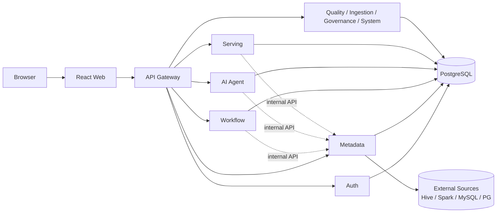

<p align="center">
  
</p>

<h1 align="center">Aetheris</h1>

<p align="center">
  一个用 AI 辅助构建的数据平台：从数据接入、数仓建模、语义层到 NL2SQL 智能问数的完整闭环
</p>

<p align="center">
  
  
  
  
  
  
</p>

---

## 这是什么

Aetheris 是一个**个人主导、AI 辅助**构建的数据平台项目。它的目标不是"又一个数据中台"，而是验证一件事：**一个工程师能否独立设计并实现一套企业级数据系统的核心闭环**。

包含 10 个 Spring Boot 微服务 + 1 个 React 控制台，覆盖数据接入、五层数仓（ODS / DWD / DWS / ADS / DIM）、元数据与血缘、SQL 任务调度、数据质量、语义层与指标生命周期、可视化看板、NL2SQL 智能问数、统一权限模型。

**它不是 demo**：所有功能建立在真实数据、真实执行、真实测试之上。数仓底座是 **130 万订单 / 320 万明细 / 180 个分区**的电商域数据集；ODS 层刻意注入 **11 类脏数据**（空值、重复行、非法枚举、负价格、逻辑删除未过滤等），DWD 逐条清洗——这些脏数据是质量规则与 DataAgent 的真实作用对象，不是装饰。

项目文档本身就是作品的一部分：[架构决策记录](docs/architecture.md)、[产品成熟度路线图](docs/roadmap.md)、[权限模型](docs/permission-model.md)、[数仓分层与测试数据设计](docs/warehouse-layers.md)、[迭代总结](docs/SUMMARY-2026-08-30.md)。

## 为什么值得看

如果你只挑三个点看，看这三个。

### 1. NL2SQL 的三层防护：让 LLM 查数据库不出事

市面上的 ChatBI 大多死在两个地方：模型乱猜表名、生成的 SQL 不安全。Aetheris 的 DataAgent 把这件事当成**安全工程**来做，不是接个 LLM API 就上线：

| 层 | 机制 | 作用 |
| --- | --- | --- |
| 语句守卫 | `validateReadOnlySql` 白名单只放行 `SELECT / SHOW / DESCRIBE / EXPLAIN`，危险函数黑名单，拒绝多语句 | agent 生成的 SQL 与人工输入受同一套约束，未放宽任何限制 |
| 账号隔离 | agent 使用只读数据库账号，仓库目录对其他用户为 `r-x` | 即便守卫被绕过也无法写入 |
| 网络隔离 | 工具端点走 `/internal/**`，网关只路由 `/api/**` | 外部直接调用返回 404（实测验证） |

工具链是**语义层指标优先、元数据检索兜底**：模型先调 `searchMetrics` 查企业已发布指标，没有匹配再回退到 `searchTables → describeTable → query` 三段式。系统提示固化四条纪律——必须先检索再看结构再查询、统计优先用 ADS/DWS、查询必须带 dt 分区条件、以字段注释为口径依据。实测"2026 年 8 月销售额最高的品类"，agent 自主选择 ADS 层、带上 `month_key` 过滤，回答正确并说明口径来源。

详见 [docs/architecture.md 的 DataAgent 章节](docs/architecture.md)。

### 2. 语义层不是 ORM，是指标资产生命周期管理

Aetheris 的语义层实现了 OneData 方法论的核心：业务域 → 逻辑模型 → 语义维度 → 指标，全部绑定真实表与字段。关键在于**发布生命周期**：

```text
首次草稿 ──校验/试算──▶ 发布 v1 ──创建新版本──▶ v1 在线 + v2 草稿
   │                         │                         ├──发布──▶ v2 在线
   └──可删除                 └──可下线                 └──放弃──▶ 恢复 v1
```

- 编码是稳定身份，创建后不可修改
- 每次发布生成**不可变快照**；线上版本和下一版草稿并行，编辑草稿不会中断现有消费者
- 指标执行器只编译受控的 `SUM / COUNT / COUNT_DISTINCT / AVG / MIN / MAX`，标识符必须来自已采集的真实表结构
- 消费者（看板、DataAgent、外部 API）只提交指标编码 + 维度 + 时间粒度 + 日期范围，不提交任意 SQL

这套设计解决的是"开始编辑 v2 就让 v1 下线"的常见故障，以及"每个人都能写 SQL 导致口径爆炸"的治理问题。

### 3. 企业级权限模型：RBAC + 资源授权 + 数据范围 + 权限版本

不是简单的 admin / viewer 两级：

- **资源层级**：组织 → 项目空间 → 业务域 → 表 / 字段 / 指标 / 数据集 / 看板 / 数据服务
- **动作分离**：`view / query / create / update / delete / submit_review / approve / publish / grant / execute / export / manage`，读权限与写权限分离，写动作永不默认放行
- **数据范围（DataScope）**：授权可叠加 `kind=domain/table/field/metric` 的取值范围，实现"有表权限但无字段权限时字段被拒绝"的细粒度控制
- **权限版本**：每次授权变更递增 `permission_version`，业务服务不做长缓存，实时询问决策引擎，避免旧权限长期生效
- **失败模式 fail-closed**：判定服务不可用一律拒绝

详见 [docs/permission-model.md](docs/permission-model.md)。

## 核心架构



**关键决策：SQL 执行能力下沉到 metadata 服务，而不是分散在 workflow / ai-agent / serving**

metadata 已持有数据源凭据、JDBC 驱动（含 hive-jdbc 的 12 处 exclusion）、`buildUrl` 的协议校验和危险连接参数黑名单。把这些复制到其他服务不只是重复代码，而是**复制一份安全边界**——两边任一处遗漏就是缺口。所有 SQL 执行走 `/internal/**` 路径，仅在 Compose 内部网络可达。

两条 SQL 路径的守卫：

| 路径 | 守卫 | 放行 | 用途 |
| --- | --- | --- | --- |
| 只读查询 | `validateReadOnlySql` | `SELECT / SHOW / DESCRIBE / EXPLAIN` | 数据源浏览、AI 助手、即席查询 |
| 写入执行 | `SqlWriteGuard` | `INSERT INTO/OVERWRITE`、`CREATE ... AS SELECT` | 数仓加工任务 |

两条路径都拒绝多语句、`DROP / TRUNCATE / ALTER / GRANT` 与可读服务器文件的函数。写入白名单刻意不含 `DROP`：`INSERT OVERWRITE` 覆盖分区已能满足重跑，不需要先删表。

### 服务清单

| 服务 | 端口 | 职责 |
| --- | ---: | --- |
| `gateway` | 8080 | API 路由、JWT 校验、角色门禁、请求头注入、限流 |
| `auth-service` | 8087 | 账号、RBAC、资源授权、数据范围、权限版本、JWT 签发 |
| `metadata-service` | 8082 | 数据源、元数据、数仓地图、血缘、SQL 双守卫、受控执行 |
| `workflow-service` | 8088 | SQL 任务、Quartz JDBC JobStore 集群调度、依赖拓扑、幂等重跑 |
| `ai-agent` | 8086 | DataAgent 工具调用循环、会话管理、Spring AI + DeepSeek |
| `serving-service` | 8089 | 数据集、看板、查询缓存、语义指标消费 |
| `quality-service` | 8083 | 质量规则（非空/范围/枚举/重复/自定义 SQL）、结果留痕 |
| `ingestion-service` | 8084 | 跨数据源批量接入、事务写入、并发互斥 |
| `governance-service` | 8085 | 治理策略、分类分级、问题记录 |
| `system-service` | 8081 | 平台配置、审计日志、失败待办 |
| `web` | 5173 | React 18 + Ant Design 5 控制台 |

业务服务默认仅开放在 Compose 内部网络，对外统一经过网关。

## 工程纪律

这个项目用做产品的标准做个人项目。

**成熟度分级**（[docs/roadmap.md](docs/roadmap.md)）：每个模块标记为 规划 / 可用 / 完整 / 企业级，"页面可点击"不等于"能力完成"。新能力至少要同时满足：真实数据、后端校验、角色边界、失败反馈、数据库迁移、自动化回归和 Docker 升级验证。

**刻意注入的脏数据**（[docs/warehouse-layers.md](docs/warehouse-layers.md)）：ODS 层保留 11 类真实业务中会遇到的数据质量问题，DWD 逐条清洗。这是质量规则与 DataAgent 的真实训练场。

**真实的踩坑记录**（[CHANGELOG.md](CHANGELOG.md)，10 轮迭代）：

- Spark driver OOM：`local[N]` 下 driver 兼作 executor，1g 堆写百万订单即爆 → 默认 3g
- 动态分区写耗尽堆：单个 task 同时持有全部分区的 Parquet writer → 写分区语句末尾统一补 `DISTRIBUTE BY dt`
- Quartz 调度 misfire 策略选 `DoNothing`：停机期间错过的触发不补跑，避免用错误的业务日期执行
- JSqlParser 4.9 解析不了 Hive 的 `INSERT OVERWRITE TABLE ... PARTITION` → 自研 Hive 方言提取器
- SQL 守卫顺序缺陷：以注释开头的真实加工脚本被误拒 → 先剥离注释与字符串字面量再检查

**版本选择依据**：升级前查询 Maven Central 实际发布的构件（而非二手资讯），确认 Spring AI 1.0.0 依赖 `spring-boot-starter 3.4.5`，因此 Boot 选 3.4.7 对齐。网络上"Spring AI 2.0 GA / Spring Boot 4.x 已发布"的说法与 Maven Central 事实不符。

**测试覆盖**：`ai-agent` 20 个单测（controller + LLM 适配器 + 限流器），`auth` 18 个，`workflow` 覆盖任务执行幂等、并发拒绝、上游跳过、重试、占位符替换。CI 包含跨服务冒烟链路：真实验证登录、批量接入、工作流写入、质量检查、分析查询和 viewer 越权拦截。

**减法的自觉**：不引入 Nacos（执行引擎未稳定时避免扩大运维复杂度）、不引入 pgvector（表数少时关键词够用，且 Alpine→Debian 的 collation 迁移成本）、不自动生成跨表 JOIN（跨表关系用于建模和校验，在已知边界里坦白写）。

## 技术栈

| 层次 | 技术 |
| --- | --- |
| 前端 | React 18、TypeScript、Vite、Ant Design 5、ECharts、React Grid Layout、TanStack Query |
| 后端 | Java 21、Spring Boot 3.4.7、Spring Cloud Gateway 2024.0.1、MyBatis-Plus 3.5.7 |
| 调度与智能 | Quartz JDBC JobStore（集群模式）、Spring AI 1.0.0、DeepSeek API |
| 数据与迁移 | PostgreSQL 16、Flyway、Caffeine Cache |
| 工程化 | Maven 多模块、Docker Compose、Nginx、GitHub Actions |

## 快速开始

### 环境要求

- Docker Desktop 与 Docker Compose
- Git
- 本地开发可选：Java 21、Maven 3.9+、Node.js 22+

### 1. 获取项目

```bash
git clone https://github.com/mazhuce/Aetheris.git
cd Aetheris
```

### 2. 配置环境变量

```bash
cp .env.example .env
```

首次启动前至少修改：

```dotenv
JWT_SECRET=请替换为足够长的随机密钥
INITIAL_ADMIN_PASSWORD=请设置初始管理员密码
AETHERIS_DATASOURCE_MASTER_KEY=请填入 openssl rand -base64 32 生成的值
```

启用 DataAgent 还需配置 `DEEPSEEK_API_KEY`。

### 3. 启动完整环境

```bash
docker compose up --build -d
docker compose ps
```

| 地址 | 用途 |
| --- | --- |
| `http://localhost:5173` | Web 控制台 |
| `http://localhost:8080` | API Gateway |
| `localhost:5433` | PostgreSQL 宿主机映射 |

### 4. 启动数仓测试环境（可选）

```bash
bash scripts/wsl-hive-test-server.sh start     # WSL Spark Thrift Server
bash scripts/gen-warehouse-data.sh              # 建库 + 造数 + 逐层加工 + 校验
pwsh ./scripts/windows-wsl-hive-relay.ps1 start # 端口转发（Docker 访问 WSL）
```

然后在数据源管理页新建 `WSL · Spark Thrift` 数据源，采集元数据，即可看到五层数仓、17 条血缘、完整的语义层和 DataAgent 链路。

## 本地开发

```bash
# 前端热更新（后端继续在 Docker 中）
make dev

# 本地运行单个后端服务
mvn -f pom.xml -s scripts/maven-mirror-settings.xml -pl services/metadata spring-boot:run

# 全部测试
mvn -f pom.xml -s scripts/maven-mirror-settings.xml test
cd apps/web && npm test && npm run type-check && npm run build

# 跨服务冒烟
INITIAL_ADMIN_PASSWORD=... POSTGRES_PASSWORD=... make smoke
```

## 目录结构

```text
Aetheris/
├── apps/
│   ├── gateway/              # API 网关（Spring Cloud Gateway）
│   └── web/                  # React 控制台
├── services/
│   ├── auth/                 # 认证、RBAC、资源授权
│   ├── system/               # 系统配置、审计、待办
│   ├── metadata/             # 数据源、元数据、血缘、SQL 守卫、受控执行
│   ├── quality/              # 数据质量
│   ├── ingestion/            # 数据接入
│   ├── governance/           # 数据治理
│   ├── workflow/             # 任务编排、Quartz 调度
│   ├── ai-agent/             # DataAgent
│   └── serving/              # 数据集、看板、指标消费
├── scripts/                  # 数仓造数、WSL 环境、构建脚本
├── docs/                     # 架构、权限、数仓、迭代文档
├── docker-compose.yml        # 生产式本地编排
└── pom.xml                   # Maven 多模块入口
```

## 文档

**核心设计**：

- [架构设计](docs/architecture.md) — 关键决策、SQL 双守卫、DataAgent 三层防护、AI 能力分层
- [权限模型](docs/permission-model.md) — RBAC + 资源授权 + 数据范围 + 权限版本
- [产品能力路线图](docs/roadmap.md) — 成熟度定义、能力矩阵、已知边界

**数据底座**：

- [数仓分层与测试数据](docs/warehouse-layers.md) — 五层设计、11 类脏数据、口径定义
- [数据源连通性](docs/datasource-connectivity.md) — WSL / Docker / Hive 网络拓扑

**迭代记录**：

- [迭代总结 2026-08-30](docs/SUMMARY-2026-08-30.md) — Phase 0-3 完整复盘
- [CHANGELOG](CHANGELOG.md) — 10 轮迭代的踩坑与修复

## 关于作者

个人项目，用 Trae CN + Claude / DeepSeek 辅助开发。目标是用一套完整的作品证明：**独立工程师 + AI 协作，可以交付过去需要一个小团队才能完成的系统**。

如果你对这个项目或数据中台 / NL2SQL / 语义层方向有兴趣，欢迎交流。

## License

待定。当前代码仅用于技术展示与学习交流。

---

<p align="center">Aetheris · 让数据有序流动，让价值清晰发生。</p>
