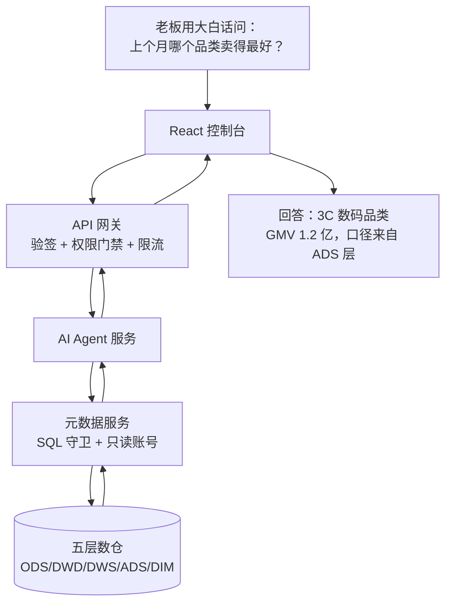

# Aetheris 数据平台 · 全项目深度审查报告

> 审查日期：2026-09-11
> 审查范围：整个 monorepo（10 个 Spring Boot 微服务 + 1 个 React 控制台 + 数仓脚本 + 工程配置）
> 报告定位：一份「写给两种读者」的技术报告 —— 面向顶级专家的工程剖析，与面向大一新生的通俗导读，两者交织在同一份文档里。

---

## 目录

- [0. 一句话结论](#0-一句话结论)
- [1. 这个项目是什么（给大一新生的导读）](#1-这个项目是什么)
- [2. 代码体量全景](#2-代码体量全景)
- [3. 总体架构与模块职责地图](#3-总体架构与模块职责地图)
- [4. 服务间如何连接：一张通信关系网](#4-服务间如何连接)
- [5. 安全设计：这不是演示项目，这是安全工程](#5-安全设计)
- [6. 性能设计：从 SQL 分区到分布式调度](#6-性能设计)
- [7. 功能设计上的巧妙与创新点](#7-功能设计上的巧妙与创新点)
- [8. 每个模块深入剖析](#8-每个模块深入剖析)
- [9. 工程纪律与踩坑记录](#9-工程纪律与踩坑记录)
- [10. 已知边界与下一步建议](#10-已知边界与下一步建议)

---

## 0. 一句话结论

> **Aetheris 不是「又一个数据中台 demo」，而是一个独立工程师用「做产品、做安全工程」的标准，在 3.2 万行 Java + 2 万行 TypeScript 里，把「数据接入 → 五层数仓 → 元数据与血缘 → 语义层 → 指标发布 → 调度执行 → 质量 → 治理 → 可视化 → NL2SQL 智能问数 → 统一权限」这条企业级数据平台闭环，真正跑通了的完整作品。**

它最打动人的地方不在于功能多（功能多但浅的 demo 比比皆是），而在于**三条贯穿始终的工程价值观**：

1. **安全不靠口号，靠「纵深防御」和「白名单」** —— SQL 守卫、账号隔离、网络隔离、身份签名验签、权限 fail-closed，层层叠加。
2. **执行可靠不靠运气，靠数据库事务的原子语义** —— 用 fencing token、租约、心跳、SKIP LOCKED 这些分布式系统原语，硬生生把「多副本并发、进程崩溃、远端失联」这些最难的问题用 PostgreSQL 解决了。
3. **AI 不是装饰，是「被安全边界管住的生产力」** —— NL2SQL 的三层防护让大模型查库不出事，语义层让模型不自己发明口径。

---

## 1. 这个项目是什么（给大一新生的导读）

如果你刚上大学、刚学完第一门编程语言，你可能对「数据中台」这个词一脸懵。别急，我用一个比喻讲清楚。

**想象一家电商公司。** 每天都有海量的订单、用户、商品数据，散落在各个系统里。老板想知道「上个月哪个品类卖得最好」，一个新手程序员可能写一句 SQL 直接查原始数据，但会遇到一堆问题：

- 原始数据里**有脏东西**：空值、重复行、写错的枚举、负价格、已删除但没清理的订单……
- 数据量**巨大**：几百万行，直接统计会卡死。
- 每个人**口径不一样**：「销售额」到底是下单就算、还是付款才算？「有效订单」怎么定义？

数据平台，就是**系统地解决这些问题的一套基础设施**。Aetheris 把这套东西完整做出来了：

| 你老板的诉求 | Aetheris 对应的能力 |
| --- | --- |
| 「把各处的数据收进来」 | **数据接入（ingestion）**：从不同数据库批量搬数据 |
| 「数据先原样存好，别急着改」 | **贴源层 ODS**：保留原始脏数据，是真相的底片 |
| 「把脏数据洗干净」 | **明细层 DWD**：去重、纠正、标准化，逐条清洗 |
| 「洗干净后按主题汇总」 | **汇总层 DWS / 应用层 ADS**：口径固化的最终结果 |
| 「想知道哪张表哪来的」 | **元数据 + 血缘（lineage）**：数据的「户口本」和「族谱」 |
| 「统一口径，别各说各话」 | **语义层 + 指标（metric）**：定义「GMV 是什么」，一次定义处处用 |
| 「每天自动跑，失败了告诉我」 | **任务调度（workflow）**：Quartz 定时、依赖编排、失败待办 |
| 「数据质量要盯住」 | **数据质量（quality）**：规则检查、结果留痕 |
| 「做个好看的看板」 | **可视化看板（serving）** |
| 「直接用大白话问数」 | **智能问数（DataAgent）**：NL2SQL，让 LLM 帮你查 |
| 「谁能看什么、谁能改什么」 | **统一权限（RBAC）**：从角色到字段级的精细控制 |

**这套系统的两个关键词**，也是你接下来几年会反复听到的：

- **分层**：数据从「原始」到「干净」到「汇总」是一条流水线，每层职责清晰，就像工厂的「原料仓 → 清洗车间 → 组装线 → 成品仓」。
- **解耦**：10 个微服务各管一摊，通过 HTTP 通信，任何一个挂了不影响其他，就像一家公司分了很多部门。

下面这张图，是整个系统从「老板提问」到「系统回答」的全过程：



你看，一次看似简单的问数，背后走了 5 个环节，每一环都做了安全检查。这就是企业级系统的样子——**简单的问题，用一套不简单的、但每一环都可解释的机制来保证答案可信。**

---

## 2. 代码体量全景

> 统计口径：`*.java`、`*.ts/tsx`、Flyway `*.sql`、`scripts/**`。已排除 `node_modules`、构建产物、日志、`target/`。

### 2.1 总量一览

| 类别 | 数量 |
| --- | ---: |
| **Java 后端代码** | **约 32,441 行** |
| **TypeScript/React 前端代码** | **约 19,560 行** |
| **Flyway 数据库迁移文件** | **110 个** |
| **数仓造数/加工 SQL** | 约 1,040 行 |
| **Python 辅助脚本（造数/Spark runner）** | 约 1,135 行 |
| **测试文件** | 约 100 个 |

**合计手写核心代码约 5.4 万行**，加上 110 个数据库迁移、数仓脚本和测试，构成了一个体量真实、绝非玩具的系统。

### 2.2 后端按服务拆分（Java）

| 服务 | 文件数 | 代码行数 | 规模占比 |
| --- | ---: | ---: | ---: |
| `metadata-service`（元数据/语义层/SQL 守卫） | 124 | **9,433** | 29% |
| `workflow-service`（调度/执行/资源队列） | 75 | **7,737** | 24% |
| `auth-service`（认证/RBAC/权限） | 83 | **4,768** | 15% |
| `serving-service`（数据集/看板/指标消费） | 32 | 2,007 | 6% |
| `system-service`（配置/审计/待办） | 49 | 1,834 | 6% |
| `ai-agent`（DataAgent） | 29 | 1,775 | 5% |
| `gateway`（网关/限流/身份签名） | 15 | 1,433 | 4% |
| `quality-service`（数据质量） | 24 | 1,426 | 4% |
| `ingestion-service`（数据接入） | 22 | 1,238 | 4% |
| `governance-service`（数据治理） | 17 | 790 | 2% |

> **观察**：`metadata` + `workflow` 两个服务占了全后端 **53%** 的代码量。这非常合理——因为它们承载了整个系统最硬核的两块：**元数据/语义层/SQL 安全边界**（metadata），和**可靠执行/分布式调度**（workflow）。代码量分布本身，就是这个项目「把力气花在刀刃上」的直接证据。

### 2.3 数据库迁移分布

| 服务 | 迁移文件数 | 说明 |
| --- | ---: | --- |
| metadata | 36 | 元数据/语义层/血缘/查询审计的表结构演进 |
| workflow | 28 | 执行快照/租约/资源队列/流水线的表结构 |
| system | 10 | 审计日志、待办、权限事件 |
| auth | 8 | RBAC 角色、资源授权、权限版本 |
| quality | 8 | 质量规则与结果留痕 |
| ingestion | 6 | 批量接入与事务写入 |
| serving | 6 | 数据集、看板、订阅、授权 |
| governance | 4 | 治理策略、分类分级、问题 |
| ai-agent | 4 | 会话与消息持久化 |

> 每个服务用 **独立的 schema**（如 `metadata.*`、`workflow.*`、`auth.*`）管理自己的 Flyway 迁移，互不干扰。这是「数据库隔离」的落地，也是为什么 10 个服务能共用一个 PostgreSQL 而不打架。

---

## 3. 总体架构与模块职责地图

### 3.1 分层架构

```text
┌─────────────────────────────────────────────────────────┐
│                    浏览器 (Browser)                      │
└───────────────────────────┬─────────────────────────────┘
                            │ HTTP
┌───────────────────────────▼─────────────────────────────┐
│                 Web 控制台 (React 18 + Ant Design 5)      │
│                 Nginx 托管，端口 5173                     │
└───────────────────────────┬─────────────────────────────┘
                            │ /api/**
┌───────────────────────────▼─────────────────────────────┐
│            API 网关 (Spring Cloud Gateway, 8080)         │
│   JWT 验签 · 身份签名注入 · 粗粒度权限门禁 · 限流 · 审计  │
└──────┬──────┬──────┬──────┬──────┬──────┬──────┬─────────┘
       │      │      │      │      │      │      │
    ┌──▼──┐ ┌▼───┐ ┌▼────┐ ┌▼───┐ ┌▼───┐ ┌▼───┐ ┌▼────┐
    │auth│ │system│ │meta-│ │quality│ │ingest│ │govern│ │workflow│
    │8087│ │8081│ │data │ │8083│ │8084 │ │8085 │ │8088│
    └──┬──┘ └──┬──┘ │8082 │ └──┬──┘ └──┬──┘ └──┬──┘ └──┬──┘
       │       │    └──┬──┘     │       │       │       │
       │       │       │        │       │       │       │
    ┌──▼───────▼───────▼────────▼───────▼───────▼───────▼──┐
    │        PostgreSQL 16（每个服务独立 schema）            │
    └───────────────────────────────────────────────────────┘

     ┌──────────┐   ┌──────────┐
     │ ai-agent │   │ serving  │
     │ 8086     │   │ 8089     │
     └──────────┘   └──────────┘
         （都通过 metadata 的内部端点访问数据）
```

### 3.2 每个模块「一句话职责 + 一段职责」

| 模块 | 一句话职责 | 详细职责 |
| --- | --- | --- |
| **gateway** | 唯一的对外入口 | JWT 验签、身份签名（X-Aetheris-Identity）、粗粒度写权限门禁、基于 Redis 的限流、审计日志、把 `/api/**` 路由到各服务。**业务服务不开对外端口，全部经网关。** |
| **auth-service** | 账号与权限的裁判 | 登录认证、JWT 签发、RBAC 角色、资源授权（resource_grant）、数据范围（DataScope）、权限版本（permission_version）。对外提供 `/internal/permissions/check` 供其他服务实时问询。 |
| **system-service** | 平台的基础设施 | 平台配置、审计日志、失败待办（「我的待办」）、服务健康信息聚合。 |
| **metadata-service** | 整个系统的「数据大脑」 | 数据源管理、元数据采集、数仓地图、表级/字段级血缘、**SQL 双守卫**、受控执行、**语义层（业务域/逻辑模型/维度/指标 + 发布生命周期）**、查询审计。**所有 SQL 执行能力下沉到这里。** |
| **quality-service** | 数据质量的质检员 | 质量规则（非空/范围/枚举/重复/自定义 SQL）、检查结果留痕、失败写待办。 |
| **ingestion-service** | 数据的搬运工 | 跨数据源批量接入、事务写入、并发互斥。 |
| **governance-service** | 数据的治理者 | 治理策略、分类分级、问题记录。 |
| **workflow-service** | 数据加工的执行引擎 | SQL 任务、Quartz JDBC JobStore 集群调度、依赖拓扑、幂等重跑、**受管 Spark**、混合流水线 DAG、资源队列、断点续跑。 |
| **ai-agent** | 让老板用大白话问数 | DataAgent 工具调用循环、会话管理、Spring AI + DeepSeek 适配、按用户限流。 |
| **serving-service** | 数据的出口 | 数据集、看板、查询缓存、语义指标消费、数据服务订阅与授权。 |

### 3.3 一个贯穿全局的关键决策

> **「SQL 执行能力下沉到 metadata，而不是分散在各服务」**

这是整个架构里最值得说的一笔。`workflow`、`ai-agent`、`serving`、`quality` 这些服务**都需要**查数据源、执行 SQL，但设计者没有让它们各自去连数据库、各自保存数据源凭据和 JDBC 驱动。为什么？

因为**数据源凭据、JDBC 驱动、SQL 守卫、连接参数黑名单，是一整套「安全边界」**。如果每个服务都复制一份，那就等于**复制了一份安全边界**——任何一个服务漏打一个补丁，就是一个可以被利用的缺口。

所以：**所有 SQL 执行都走 metadata 的 `/internal/**` 端点**。而 `/internal/**` 路径，网关根本不会路由（网关只路由 `/api/**`），所以它**只能在 Docker Compose 的内部网络里被访问，外部直接调用返回 404**（这个结论是实测验证过的，不是文档说说而已）。

这一笔，同时解决了**代码复用**和**安全收敛**两个问题，是架构层面的「一次正确决策，避免十处漏洞」。

---

## 4. 服务间如何连接：一张通信关系网

微服务最大的难点，就是「它们到底怎么互相调用」。Aetheris 的通信关系非常克制、清晰，分三种类型：

### 4.1 三类通信

| 类型 | 说明 | 例子 |
| --- | --- | --- |
| **对外 API**（`/api/**`） | 仅网关可路由，浏览器经网关访问 | 前端 → 网关 → 各服务 |
| **内部 API**（`/internal/**`） | 服务间调用，网关不路由，外部 404 | workflow → metadata 执行 SQL |
| **数据库共享** | 各服务用独立 schema 访问同一个 PostgreSQL | 每个服务读写自己的表 |

### 4.2 关键的服务间调用

```text
workflow ──/internal/sql/execute──▶ metadata  （SQL 加工任务执行）
quality  ──/internal/sql/...─────▶ metadata  （质量规则的自定义 SQL）
ai-agent ──/internal/agent/**────▶ metadata  （5 个工具的检索与查询）
serving  ──/internal/semantic/**──▶ metadata  （语义指标查询）
workflow ──/internal/quality/...─▶ quality  （流水线中的质量门禁）
workflow ──/internal/notify──────▶ system   （失败写待办）
gateway  ──/internal/permissions▶ auth      （粗粒度权限问询）
各服务   ──/internal/permissions─▶ auth      （资源级权限判定）
```

### 4.3 服务间信任的基石：内部令牌 + 身份签名

服务间调用不是「裸奔」的，靠两道机制保护：

1. **X-Internal-Token**：服务间调用必须携带一个共享的内部令牌，由 `InternalTokenInterceptor` 校验。没有令牌，内部端点直接拒绝。
2. **X-Aetheris-Identity**：网关把「经过 JWT 验签的用户身份」用 HMAC-SHA256 再签一次名，注入请求头。业务服务收到后**重新验签**，确认「这个身份确实经过网关认证」，而不是信任客户端可以伪造的 `X-User-Name` 头。

这套设计回答了微服务安全里最经典的问题：**「我怎么知道这个请求真的是那个用户，而不是别人伪造的？」** 答案是——**用签名，而不是用信任明文头。**

---

## 5. 安全设计：这不是演示项目，这是安全工程

这是整个项目里我最想重点讲的部分。很多个人项目、甚至商业项目，安全都是「事后想起来补一下」，而 Aetheris 的安全是**从架构第一天就内建的、多层叠加的**。我把它拆成「纵深防御的六层」。

### 5.1 第一层：SQL 注入与危险语句的「白名单守卫」

数据平台的核心风险是：**用户（或 AI）提交的 SQL，可能删库、改权限、读服务器文件。** Aetheris 用两道守卫挡住了：

**只读守卫 `validateReadOnlySql`**：只放行 `SELECT / SHOW / DESCRIBE / EXPLAIN`，其他一律拒绝。

**写入守卫 `SqlWriteGuard`**（专门给数仓加工任务用）：白名单只放行
- `INSERT INTO / OVERWRITE ... SELECT`（数仓分层加工的主力写法）
- `CREATE TABLE/VIEW ... AS SELECT`（建中间表）

**并且两条路径都拒绝**：多语句（分号注入）、`DROP / TRUNCATE / ALTER / GRANT / REVOKE`、以及 `PG_READ_FILE`、`LOAD_FILE`、`SLEEP`、`REFLECT` 这类「语法合法但能读服务器文件、探测端口、阻塞连接」的危险函数。

这里有两个**非常专业**的细节，值得单独拎出来说：

**细节一：先剥离「噪声」，再检查。** 守卫不是拿原始 SQL 直接匹配，而是**先把注释和字符串字面量剥掉**再检查。为什么？因为：
- 以注释开头的真实加工脚本（很常见的写法）如果用原始文本匹配白名单，会被误拒；
- 注释里的分号（如 `-- 见工单; 紧急`）会被误判成多语句；
- 注释里的「勿 DROP 此表」会被误拦，而字符串字面量里藏的关键字反而可能漏判。

```java
// 顺序很关键：先 stripNoise 剥离注释与字符串，再检查
String scannable = stripNoise(cleaned).trim();
```

这个「先降噪、再判定」的顺序，是踩过真实坑之后才总结出来的（CHANGELOG 里有记录：「以注释开头的真实加工脚本被误拒 → 先剥离注释与字符串字面量再检查」）。

**细节二：白名单而非黑名单。** 黑名单是「列出禁止的」，总会有漏网之鱼；白名单是「只列出允许的」，没列出的全拒绝。后者安全得多。而且写入白名单**刻意不含 `DROP`**——因为 `INSERT OVERWRITE` 覆盖分区已经能满足重跑需求，不需要先删表，那就干脆把删表这个能力彻底关掉。

### 5.2 第二层：账号隔离（即便守卫被绕过也无写权限）

SQL 守卫是「软件层」的防线。但万一守卫被绕过呢？答案是**账号隔离**：

- 数仓加工任务用 **HDFS 仓库属主身份**连接（有写权限）；
- 只读查询与 AI 助手用 **`aetheris` 只读账号**连接（仓库目录对其他用户是 `r-x`，即只能读、执行，不能写）。

所以即使 DataAgent 的 SQL 守卫被绕过了，它拿的账号**在数据库层面就没有写权限**，想写也写不进去。这叫「纵深防御」——不把鸡蛋放在一个篮子里。

### 5.3 第三层：网络隔离（内部端点外部不可达）

工具端点和 SQL 执行端点都走 `/internal/**`，而网关只路由 `/api/**`。所以这些危险端点**在 Compose 内部网络之外根本不可达**，外部直接调用返回 404（实测验证）。

### 5.4 第四层：身份签名与常量时间比较

业务服务不信任浏览器传来的任何明文身份头。网关用共享令牌对 `uid|username|timestamp` 做 HMAC-SHA256 签名，业务服务验签。而且验签用**常量时间比较**（`constantTimeEquals`），防止时序侧信道攻击——即不让攻击者通过「比较时间的长短」来逐字节猜出签名。

```java
private static boolean constantTimeEquals(String expected, String actual) {
    // 逐字节异或，不提前返回，避免时序泄露
    int result = a.length ^ b.length;
    for (int i = 0; i < a.length && i < b.length; i++) {
        result |= a[i] ^ b[i];
    }
    return result == 0;
}
```

这个细节，很多商业系统的网关都未必做到。

### 5.5 第五层：企业级权限模型（RBAC + 资源授权 + 数据范围 + 权限版本）

这不是简单的「admin / viewer」两级。而是四维叠加：

- **资源层级**：组织 → 项目空间 → 业务域 → 表 / 字段 / 指标 / 数据集 / 看板 / 数据服务。
- **动作分离**：`view / query / create / update / delete / submit_review / approve / publish / grant / execute / export / manage`。**读权限和写权限分离，写动作永不默认放行。**
- **数据范围（DataScope）**：授权可叠加取值范围（如「只能看业务域 5、6」），实现「有表权限但无字段权限时字段被拒绝」的细粒度控制。
- **权限版本（permission_version）**：每次授权变更递增版本号。业务服务**不做长缓存**，每次判定实时问询 auth，避免「撤销了权限但旧权限还长期生效」。

**失败模式是 fail-closed**：权限判定服务不可用时，**一律拒绝**（业务服务返回 403，网关返回 503），而不是「为了不阻塞业务先放行」。这在安全上是绝对正确的——宁可不让你用，也不能让你绕过检查。

### 5.6 第六层：容器级安全基线

`docker-compose.yml` 里的 `x-java-runtime` 锚点，给**所有** Java 服务统一施加了：

```yaml
read_only: true            # 只读根文件系统
security_opt:
  - no-new-privileges:true # 禁止提权
cap_drop:
  - ALL                    # 丢弃所有 Linux capabilities
pids_limit: 256            # 限制进程数
mem_limit: 768m            # 限制内存
cpus: 1.0                  # 限制 CPU
```

这不是「跑起来就行」，而是**最小权限原则在容器层的落地**——即使某个服务被攻破，攻击者拿到的是一个只读、无提权、无能力、资源受限的容器，能做的事情极其有限。

### 5.7 数据源凭据的加密存储

数据源密码用 `AETHERIS_DATASOURCE_MASTER_KEY` 主密钥加密存储，主密钥通过 `openssl rand -base64 32` 生成，不写死在代码里。项目里还有一个 `DataSourceSecretMigration`，负责把历史明文密码迁移到加密存储。

---

## 6. 性能设计：从 SQL 分区到分布式调度

### 6.1 数据侧：分区与剪枝

数仓的事实表（订单、明细）**按 `dt` 字段分区**，数据量在百万级。这让「分区裁剪」成为真实的查询优化问题：

- 查询必须带 `dt` 条件，否则全表扫描超时。
- DataAgent 的系统提示里**明确要求**「查询必须带 dt 分区条件」，这是把性能约束固化进了 AI 的行为准则。

### 6.2 写入侧：`DISTRIBUTE BY dt` 防 OOM

这是 CHANGELOG 里记录的**真实踩坑**：动态分区写入时，单个 task 会同时持有全部分区的 Parquet writer，每个 writer 各缓冲一个 row group，在单机 driver 上直接耗尽堆内存。

解法是**在每个写入分区语句末尾统一补 `DISTRIBUTE BY dt`**，让数据按分区键分发，每个 task 只处理自己分区的 writer。文档里反复强调：「改这些 SQL 时不要删掉」。

### 6.3 Spark driver 内存调优

`local[N]` 模式下 driver 兼作 executor，1g 堆写百万订单就 OOM。默认调到 3g。这是「本地模式」下特有的坑，文档写得很清楚。

### 6.4 查询缓存

serving 服务用 **Caffeine Cache** 做查询缓存，避免重复查询直接打到数据源。

### 6.5 限流

三层限流：
- 网关层基于 Redis 的限流（`AETHERIS_RATE_LIMIT_CAPACITY`）；
- serving 服务自身的令牌桶限流；
- ai-agent 按用户限流（`UserRateLimiter`），防止单个用户刷爆 LLM 调用。

### 6.6 分布式调度：用 PostgreSQL 解决「最难的问题」

这部分我要重点讲，因为它体现了这个项目**最硬核的工程能力**。

**问题**：workflow 服务要支持多副本部署（集群模式），多个副本同时抢任务执行权，还要处理「进程崩溃了怎么办」「远端 Spark 失联了怎么办」。

**Aetheris 没有引入 ZooKeeper、etcd 这类分布式协调中间件，而是用 PostgreSQL 的事务和行锁，自己实现了分布式调度原语。** 具体有三件套：

**① 执行权抢占（fencing token + 唯一约束）**

```sql
INSERT INTO workflow.task_instance (task_id, biz_date, ...)
ON CONFLICT (task_id, biz_date) DO UPDATE ...
WHERE task_instance.status NOT IN ('queued','submitting','running','cancel_requested','unknown')
```

`(task_id, biz_date)` 有唯一约束，`ON CONFLICT` + `WHERE` 状态过滤，保证**同一个任务的同一个业务日期，同一时刻只能有一个活动执行**。`fencing_token` 每次抢占递增，用来**防止旧的执行者覆盖新的状态**——这就是经典的 fencing token 模式。

**② 租约 + 心跳（lease + heartbeat）**

每个执行 attempt 有 `lease_expires_at`（租约到期时间）和 `heartbeat_at`（心跳时间）。执行者定期心跳续租。如果进程崩溃、心跳停止，租约过期后由 `reconcileExpiredLeases` 回收——把排队中的标记为超时，把运行中的标记为 `unknown`（等待人工核对远端结果，而不是盲目重跑导致重复执行）。

**③ 资源队列 + SKIP LOCKED（Spark 资源准入）**

受管 Spark 任务不能无限并发，要按 CPU/内存/并发三维容量准入。`SparkResourceQueueService` 用数据库做**持久化 FIFO 队列**：

```sql
... FOR UPDATE OF runner SKIP LOCKED LIMIT 1
```

`SKIP LOCKED` 是关键——多个 workflow 副本同时抢 Runner 容量时，被锁住的行直接跳过，**不会互相阻塞，也不会超配**。这正是 CHANGELOG 里「Compose 双副本锁竞争验收」验证过的：第二个副本在 Runner 被锁定时通过 `SKIP LOCKED` 立即跳过。

> **专家点评**：这三件套（fencing token、lease/heartbeat、FOR UPDATE SKIP LOCKED）是分布式系统里最经典、最可靠的原语。很多团队会为了「看起来高大上」引入重型中间件，而这个项目证明了——**在 PostgreSQL 的强一致性事务之上，用正确的 SQL 就能实现一套足够可靠的执行引擎**。这是「减法自觉」的最佳体现。

---

## 7. 功能设计上的巧妙与创新点

### 7.1 NL2SQL 的三层防护（最有价值的设计之一）

市面上的 ChatBI 大多死在两个地方：**模型乱猜表名**、**生成的 SQL 不安全**。Aetheris 把这件事当安全工程来做：

| 层 | 机制 | 作用 |
| --- | --- | --- |
| 语句守卫 | `validateReadOnlySql` 白名单只放行 SELECT/SHOW/DESCRIBE/EXPLAIN | agent 生成的 SQL 与人工输入受同一套约束 |
| 账号隔离 | agent 用只读账号 | 即便守卫被绕过也无法写入 |
| 网络隔离 | 工具端点走 `/internal/**` | 外部直接调用 404 |

**而且工具链是「语义层指标优先、元数据检索兜底」**：模型先调 `searchMetrics` 查已发布指标，没匹配才回退 `searchTables → describeTable → query` 三段式。系统提示固化四条纪律，每条都对应数仓的真实特征（见 8.8 节）。

### 7.2 语义层不是 ORM，是指标资产生命周期管理

语义层实现了 OneData 方法论的核心：业务域 → 逻辑模型 → 语义维度 → 指标，全部绑定真实表与字段。关键在于**发布生命周期**：

```text
首次草稿 ──校验/试算──▶ 发布 v1 ──创建新版本──▶ v1 在线 + v2 草稿
   │                         │                         ├──发布──▶ v2 在线
   └──可删除                 └──可下线                 └──放弃──▶ 恢复 v1
```

- 编码是稳定身份，创建后不可修改；
- 每次发布生成**不可变快照**；线上版本和下一版草稿并行，**编辑草稿不会中断现有消费者**；
- 消费者只提交「指标编码 + 维度 + 时间粒度 + 日期范围」，**不提交任意 SQL**。

这套设计解决的是两个真实痛点：
1. 「开始编辑 v2 就让 v1 下线」的常见故障；
2. 「每个人都能写 SQL 导致口径爆炸」的治理问题。

### 7.3 受控的语义指标执行器（防止 SQL 注入的「编译而非拼接」）

`SemanticMetricQueryService` 是「把指标定义编译成受控 SQL」的典范：

- **聚合白名单**：只允许 `SUM / COUNT / COUNT_DISTINCT / AVG / MIN / MAX`；
- **标识符字符校验**：字段名/表名必须匹配 `[A-Za-z_][A-Za-z0-9_$]*`，否则拒绝——这从根本上堵死了标识符注入；
- **过滤操作符白名单**：`eq/ne/gt/gte/lt/lte/in/not_in/is_null/is_not_null`，`IN` 值数量上限 100；
- **方言感知**：`timeBucket` 根据数据源类型（Postgres/MySQL/Spark）生成不同的时间分桶表达式；
- **结果上限**：最多返回 100 行。

这是「**用白名单和字符校验，把用户的任意输入关进笼子里**」的教科书级实现。

### 7.4 自研 Hive 血缘提取器（而不是硬套 JSqlParser）

血缘解析不用 JSqlParser，因为实测 4.9 版**无法解析 Hive 的 `INSERT OVERWRITE TABLE ... PARTITION (dt)`**（项目的四类真实写法全部抛异常）。于是自研了一个面向 Hive 方言的词法提取器，覆盖 `INSERT OVERWRITE/INTO`、`LATERAL VIEW`、`DISTRIBUTE BY`、`CREATE TABLE AS SELECT`，并**刻意排除 CTE 名称、表值函数、自引用、注释与字符串字面量**，避免产生不存在的表节点。

这个决策体现了「**实事求是，不迷信现成库**」——当现成工具不适用时，敢于自己写一个更贴合场景的，并清楚地写明边界（当前是表级血缘，字段级要等真正的 Hive 方言 AST 解析器）。

### 7.5 幂等重跑设计

- **实例幂等**：`(task_id, biz_date)` 唯一，重跑复用同一行并累加 attempt，列表不膨胀，也排除了并发写入；
- **数据幂等**：加工语句用 `INSERT OVERWRITE ... PARTITION` 覆盖目标分区，重跑不产生重复数据，不依赖事务回滚（Hive/Spark 本就不支持事务性 DML）。

### 7.6 AI 能力分层（换模型只换适配器）

```text
ChatController（协议转换、限流、状态码映射）
      ↓
ChatService（会话编排、校验、持久化）
      ↓
LlmClient（端口/接口）
      ↓
SpringAiLlmClient（Spring AI + DeepSeek 适配器）
```

这样 DataAgent 的核心工作（工具循环、语义层、SQL 守卫）**不与具体模型厂商耦合**，换模型只替换适配器。这是「面向接口编程」在 AI 时代的正确姿势。

---

## 8. 每个模块深入剖析

### 8.1 gateway（API 网关，1,433 行）

- **JwtAuthFilter**：JWT 验签，httponly cookie 之外仅网关可信。
- **IdentitySigner**：用共享令牌对 `uid|username|timestamp` 做 HMAC-SHA256，生成 `X-Aetheris-Identity` 头。
- **AuthPermissionGate**：粗粒度写权限问询，auth 不可用时 fail-closed（503），超时 500ms 连接 + 1.5s 响应，防止权限服务拖垮网关。
- **WriteRateLimitFilter + TokenRevocationStore**：基于 Redis 的限流与令牌吊销。
- **AuditLogFilter**：审计日志，活动流数据来源。

### 8.2 auth-service（认证与权限，4,768 行）

- RBAC 角色、权限目录、角色-权限绑定、用户组、组织、项目空间、资源授权、数据范围、权限版本。
- `sys_admin` / `sys_viewer` 系统角色不可删改，与旧 `admin/viewer` 账号通过 `auth_user_role` 映射兼容迁移。
- 对外提供 `/internal/permissions/check`、`/internal/permissions/visibility`、`/internal/permissions/mutate-check` 三个内部端点。
- **核心原则**：业务逻辑核心链路不再把 admin 硬编码为例外，统一走 `PermissionDecisionService`。

### 8.3 metadata-service（元数据与语义层，9,433 行，最大服务）

这是整个系统的「数据大脑」，职责最重：

- **数据源管理**：JDBC 驱动（含 hive-jdbc 的 12 处 exclusion）、`buildUrl` 协议校验、危险连接参数黑名单、凭据加密存储。
- **元数据采集**：层级推断（`WarehouseLayerResolver`，库名匹配不上退回表名前缀）、表注释抓取（`DESCRIBE FORMATTED` 读 Comment 行）、stale 表管理。
- **血缘**：表级血缘（`SqlLineageExtractor`）+ 字段级血缘（`FieldLineageController`、`SqlLineageExtractor` 的字段投影解析）。
- **SQL 双守卫**：`validateReadOnlySql` + `SqlWriteGuard`。
- **受控执行**：`InternalSqlExecuteController`、`InternalSqlValidateController`。
- **语义层**：业务域、逻辑模型、语义维度、指标、发布生命周期、语义资产评审。
- **查询审计**：`QueryAuditService`，哈希化查询标识、失败率/P50/P95/慢查询统计。
- **安全**：`IdentityVerifier`（验签）、`InternalTokenInterceptor`（内部令牌）、`AuthPermissionClient`（权限问询）、`MetadataSecurity`（资源级判定）。

### 8.4 workflow-service（执行引擎，7,737 行，第二大服务）

这是整个系统「可靠执行」的核心：

- **TaskSchedulerService**：Quartz JDBC JobStore 集群调度，misfire 策略 `DoNothing`（停机期间错过的触发不补跑，避免用错误业务日期执行）。
- **TaskDependencyService**：依赖拓扑，上游成功后触发下游。
- **ExecutionClaimCoordinator**：原子抢占、租约、心跳、fencing token、过期回收（见 6.6 节）。
- **ExecutionAttemptService**：不可变执行快照，attempt 固化任务定义（`definition_digest`），重试不读取漂移后的在线配置。
- **SparkResourceQueueService**：持久化 FIFO 队列 + 三维容量准入 + SKIP LOCKED（见 6.6 节）。
- **SparkBatchExecutionService**：受管 Spark，固定环境、白名单 PySpark 制品、SHA-256 校验、制作者/复核者分离、application ID、增量日志、远端确认取消。
- **PipelineExecutionService**：SQL/Spark/质量混合 DAG，提交前闭包校验、质量豁免、断点续跑。
- **GitRemoteInspector / GitRepositoryService**：Git 源码修订固定，JGit 只读解析远端分支头，40 位 commit SHA，私有仓库凭据只存 env 引用。

### 8.5 serving-service（数据服务，2,007 行）

- 数据集（AnalyticsDataset）、看板（Dashboard）、订阅（DataSubscription）、服务授权（ServiceGrant）。
- 版本化指标/只读 SQL API、查询缓存（Caffeine）、`MetadataQueryClient` 消费语义指标。
- 自身限流（`ServingRateLimiter`）。

### 8.6 quality-service（数据质量，1,426 行）

- 质量规则：非空、范围、枚举、重复、自定义 SQL。
- 结果留痕，失败写待办（通知 system-service）。

### 8.7 ingestion-service（数据接入，1,238 行）

- 跨数据源批量接入、事务写入、并发互斥。

### 8.8 ai-agent（DataAgent，1,775 行）

- **五个工具**（`DataTools`）：`searchMetrics`、`queryMetric`、`searchTables`、`describeTable`、`query`。
- **工具设计巧思**：
  - `@Tool` 描述写得极详细（用途、参数、调用顺序），因为这是模型判断「该不该调、怎么传参」的唯一依据；
  - 返回值序列化成**紧凑 JSON**，省下 token 留给表注释；
  - 工具**不抛异常**，失败返回带 `error` 字段的结构化结果，让模型能自行改写重试——抛异常会中断整轮对话。
- **系统提示**（`AgentPrompts`）固化四条纪律，每条都对应数仓真实特征：
  1. **必须先检索再看结构再查询**——避免凭字段名猜 SQL；
  2. **统计优先用 ADS/DWS**——ODS 层有脏数据，直接统计得错结论；
  3. **查询必须带 dt 分区条件**——事实表百万级，不带条件全表扫描超时；
  4. **以字段注释为口径依据**——「有效订单」「GMV」有固定定义，不让模型自己发明。
- **按用户限流**（`UserRateLimiter`）+ 会话按用户隔离持久化。
- 实测：问「2026 年 8 月销售额最高的品类」，agent 自主选 ADS 层、带 `month_key` 过滤，回答正确并说明口径来源。

### 8.9 system-service（系统管理，1,834 行）

- 平台配置、审计日志、失败待办（「我的待办」）、服务健康信息聚合。

### 8.10 governance-service（数据治理，790 行）

- 治理策略、分类分级、问题记录。

---

## 9. 工程纪律与踩坑记录

这个项目最难得的，是它把「个人项目」用「产品标准」来对待。CHANGELOG 记录了 10 轮迭代的踩坑，每一轮都是真金白银的教训：

| 踩坑 | 教训 |
| --- | --- |
| Spark driver OOM | `local[N]` 下 driver 兼 executor，1g 堆写百万订单即爆 → 默认 3g |
| 动态分区写耗尽堆 | 单 task 持有全部分区 writer → 写分区语句末尾统一补 `DISTRIBUTE BY dt` |
| Quartz misfire | 停机错过的触发不补跑 → 策略选 `DoNothing`，避免用错误业务日期执行 |
| JSqlParser 解析不了 Hive | `INSERT OVERWRITE ... PARTITION` 报错 → 自研 Hive 方言提取器 |
| SQL 守卫顺序缺陷 | 注释开头的真实脚本被误拒 → 先剥离注释与字符串字面量再检查 |

**工程纪律**还包括：

- **成熟度分级**：每个模块标记为「规划 / 可用 / 完整 / 企业级」，新能力要同时满足真实数据、后端校验、角色边界、失败反馈、数据库迁移、自动化回归、Docker 升级验证，才叫「完成」。
- **刻意注入 11 类脏数据**：ODS 层保留真实业务会遇到的脏数据（空值、重复、非法枚举、负价格、逻辑删除未过滤），让质量规则和 DataAgent 有真实的训练对象。
- **版本选择依据**：升级前查 Maven Central 实际发布的构件，而不是二手资讯（纠正了「Spring AI 2.0 GA 已发布」的谣言）。
- **测试覆盖**：ai-agent 20 个单测、auth 18 个、workflow 覆盖幂等/并发拒绝/上游跳过/重试/占位符替换。CI 含跨服务冒烟链路。
- **减法的自觉**：不引入 Nacos（执行引擎未稳定时避免扩大运维复杂度）、不引入 pgvector（表少时关键词够用）、不自动生成跨表 JOIN（在已知边界里坦白写）。

---

## 10. 已知边界与下一步建议

这个项目非常诚实——它把自己的边界写得清清楚楚（`roadmap.md`），不夸大、不掩饰。这也是它区别于「吹牛 demo」的地方。

### 10.1 已知边界（作者自己承认的）

- 语义指标以**单个受管物理表**为执行边界，多表关系用于建模和校验，尚未自动生成跨表 JOIN。
- 派生/复合指标目前仍用同一受控聚合执行器，尚无指标表达式 DAG。
- Git 集成当前验证远端分支头并固定 commit，运行器文件摘要仍由部署清单提供，尚未自动读取 Git blob、校验签名。
- 断点续跑不允许跳过 `unknown` 节点（这是对的，宁可卡住也不盲目重跑）。
- Docker Compose 是当前交付环境，Kubernetes、持续负载容量、灾备尚未宣称完成。
- 血缘当前是表级为主，字段级血缘在补强中。

### 10.2 我的下一步建议（按优先级）

1. **字段级血缘 + 语义资产依赖图 + 变更影响分析**：这是「数据资产识别最后一公里」的关键（与你近期商业化的方向直接相关），当前已有基础节点/边，缺的是「下线前跨资产自动阻断」。
2. **跨表 JOIN 的受控编译**：突破「单来源表」边界，是语义层从「可用」到「完整」的临门一脚。
3. **数据服务开放的生产化**：API key 申请/轮换、应用审批、配额持久化、分布式限流、SLA。
4. **Git blob 摘要自动比对**：把「commit 固定」升级为「代码供应链签名验证」。
5. **Kubernetes + 高可用 PostgreSQL + 备份恢复**：规模化运行的必经之路。

---

## 附：报告如何阅读

- **如果你是大一新生**：重点读第 1 节（导读）、第 3 节（架构地图）、第 5 节开头的「纵深防御」比喻。你会理解「企业级系统」到底比「课程作业」多做了什么。
- **如果你是有经验的工程师**：重点读第 5.1（SQL 白名单守卫）、第 6.6（PostgreSQL 分布式调度三件套）、第 7.2-7.4（语义层生命周期、受控指标执行器、自研血缘提取器）。这些是真正值得拿出来说的硬核实现。
- **如果你是架构师/技术负责人**：重点读第 3.3（SQL 能力下沉的决策）、第 5（纵深防御六层）、第 10（边界与建议）。

---

<p align="center">Aetheris · 让数据有序流动，让价值清晰发生。</p>
