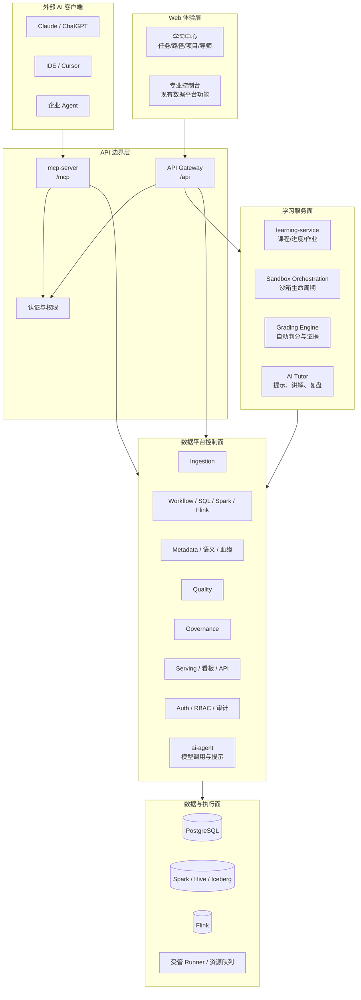
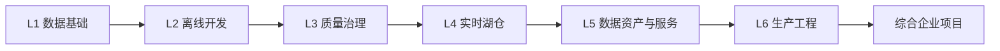
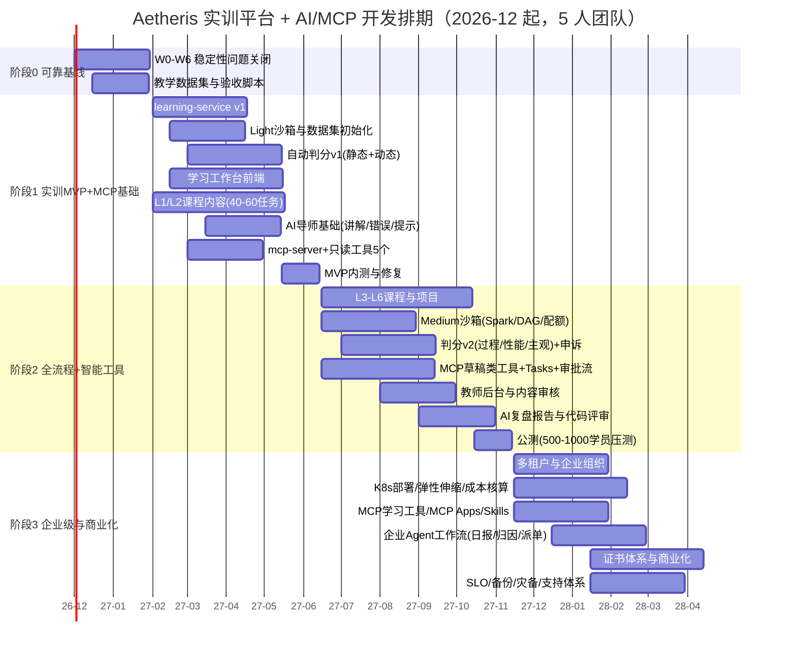

# Aetheris 数据中台实训平台总体设计与开发排期

版本：2026-11-12 v1.0（整合稿）

本文档整合自《数据中台实训平台可行性分析与系统设计》与《AI 原生能力与 MCP 暴露设计》，并新增完整的开发排期，是当前项目产品与工程建设的唯一基线文档。

> 结论先行：**技术上高度可行，产品上具备明显差异化，但不是在现有平台上补几个课程页面就能完成。** 现有 Aetheris 的控制面、数仓底座、执行审计、安全边界和测试证据体系已经超过普通原型，足以作为"真实企业环境"的教学底座；真正的缺口是四个全新系统：学习路径与课程系统、学员沙箱与资源隔离系统、自动评测与证据系统、AI 导师与复盘系统。同时，平台必须升级为 **AI 可操作的数据平台**：对内提供智能应用，对外通过 MCP 暴露标准化能力，但所有能力都建立在现有权限、审计、SQL 守卫和预算体系之上。若沿用现有工程纪律，3-5 人团队可在 6 个月交付可商用的实训 MVP + MCP 基础能力，约 15-17 个月达到企业级 GA 与商业化版本。

> **实施状态（2026-11-13）**：M2 垂直切片已落地；M3/M4 垂直切片新增内容审核与教师后台、AI 导师（可接大模型，无 Key 回退规则）、过程证据、MCP 草稿/审批/长任务、L3/L4 六个任务与两个项目。M4 全量仍未完成：L5/L6、Medium 沙箱、500-1000 并发、多租户/K8s、MCP Apps 等见 [M3/M4 实施说明](m3-m4-implementation-notes.md)。

---

## 目录

1. [现状盘点：可复用资产与真实缺口](#1-现状盘点)
2. [目标定义](#2-目标定义)
3. [可行性分析](#3-可行性分析)
4. [总体系统设计](#4-总体系统设计)
5. [学习平面核心子系统](#5-学习平面核心子系统)
6. [AI 原生能力与 MCP 暴露设计](#6-ai-原生能力与-mcp-暴露设计)
7. [安全与治理设计](#7-安全与治理设计)
8. [成功指标](#8-成功指标)
9. [开发排期](#9-开发排期)
10. [主要风险与应对](#10-主要风险与应对)
11. [关键决策建议](#11-关键决策建议)
12. [待确认问题](#12-待确认问题)
13. [总结](#13-总结)

---

## 1. 现状盘点

### 1.1 已经具备的平台能力

| 领域 | 当前能力 | 教学价值 |
| --- | --- | --- |
| 平台架构 | Gateway + 9 个业务服务 + Web 控制台，PostgreSQL、Redis、Prometheus、Docker Compose | 学员可以直接在真实微服务架构中学习，而不是看模拟页面 |
| 数据接入 | 数据源管理、批量接入、调度、执行记录、失败待办 | 可设计"从业务库到平台"的接入实验 |
| 数据开发 | SQL 任务、受管 Spark、Flink 控制面、混合 DAG、Quartz 集群调度、断点续跑 | 覆盖离线开发、实时开发和调度运维主线 |
| 数仓底座 | ODS/DWD/DWS/ADS/DIM 五层，约 130 万订单、320 万明细、180 个分区，11 类真实脏数据 | 是"数据清洗、分层建模、口径治理"的天然教材 |
| 数据质量 | 非空、范围、枚举、重复、自定义 SQL 规则，结果留痕 | 可把质量从概念课变成可执行、可评分的任务 |
| 元数据与血缘 | 表级/字段级血缘、语义依赖、影响分析 | 可训练影响分析、变更评估等高阶能力 |
| 语义层 | 业务域、逻辑模型、语义维度、指标版本与发布生命周期 | 可教学 OneData、指标口径治理、版本治理 |
| 数据服务与消费 | 数据集、看板、指标查询、API 资产、订阅授权 | 可训练"数据资产到业务消费"的完整链路 |
| 智能中心 | DataAgent、智能问数、只读 SQL 防护 | 可作为 AI 导师和智能评测的基础 |
| 权限与安全 | RBAC、资源授权、数据范围、权限版本、SQL 双守卫、审计 | 可教学企业数据安全与权限治理 |
| 工程治理 | 123 份左右 Flyway 迁移、大量单测/契约/验收脚本、成熟度分级、证据链 | 可训练工程规范、验收思维和可追溯交付 |

### 1.2 已有智能能力（ai-agent 现状）

| 能力 | 现状 | 限制 |
| --- | --- | --- |
| DataAgent 工具循环 | Spring AI `ChatClient` 驱动 `@Tool` 调用 | 只在平台内部聊天场景可用 |
| 元数据检索 | `searchTables` 支持关键词、层级过滤 | 尚未对外标准化 |
| 语义指标查询 | `searchMetrics` / `queryMetric` 优先 | 尚未对外标准化 |
| 只读 SQL | `query` 走 SQL 守卫和只读账号 | 尚未对外标准化 |
| 权限与审计 | 用户绑定、会话隔离、预算限制、审计 | 面向内部 API，不是 MCP |
| 提示词治理 | `AgentPrompts` 固化数仓纪律 | 尚未版本化管理 |
| AI 预算 | 模型调用、工具调用、token、超时、并发队列 | 尚未覆盖 MCP 客户端 |

### 1.3 当前主要缺口

**实训方向：**

1. **学习系统缺口**：代码和导航中没有课程、学习路径、实验、作业、评分、证书、学习进度等能力。
2. **学员隔离缺口**：当前权限模型面向企业用户，尚缺少面向大量学员的沙箱生命周期、资源配额、数据集快照和自动回收。
3. **自动评测缺口**：现有质量规则和执行审计可以复用，但缺少"面向学习目标"的判分器、隐藏测试集、评分细则和成长报告。
4. **教学内容缺口**：现有文档是工程文档，不是面向小白的课程；需要把平台能力重构为任务卡、企业需求工单、故障演练和项目制学习。
5. **产品形态缺口**：当前 UI 是专业控制台，小白用户会被菜单和数据平台术语劝退；需要"学习模式"作为第一入口。
6. **生产成熟度缺口**：项目自身文档明确企业 GA 尚未完成，包括安装升级、灾备、租户隔离、真实引擎验收、可观测和容量证明等。

**AI 与 MCP 方向：**

1. **没有 MCP 服务器**：项目内没有实现 `tools/list`、`tools/call`、`resources/list`、`resources/read` 等标准能力。
2. **智能应用散落在聊天场景**：SQL 生成、治理、运维、学习辅导还没有形成独立产品能力。
3. **外部 AI 客户端无法安全接入**：IDE、Cursor、Claude、ChatGPT、企业 Agent 无法把 Aetheris 当作一个受控数据工具源。
4. **工具治理缺失**：缺少工具版本、权限声明、输入输出 schema、审计和审批流。
5. **长任务能力缺失**：数据开发、质量检查、流水线执行是长任务，需要 MCP Tasks 扩展而不是一次性同步调用。

---

## 2. 目标定义

### 2.1 产品目标

建设一个"真实企业数据中台之上的实训平台"，并同时成为"AI 可操作的数据平台"：

1. 学员通过完成企业真实任务学习数据开发全流程。
2. 每个知识点都对应平台上的真实操作、真实数据和真实执行结果。
3. 系统自动判定结果、给出反馈、沉淀证据，形成可展示的能力档案。
4. 教学环境与工业级平台共用同一套控制面和安全边界，避免"培训版玩具"和"生产版系统"两张皮。
5. 平台对内提供智能应用（AI 导师、智能问数、开发副驾、治理副驾、运维诊断），对外通过 MCP 把能力开放给 Claude、ChatGPT、Cursor、企业 Agent 和 IDE。
6. 面向个人学习、高校实训、企业内训和求职作品集四类场景。

### 2.2 非目标

以下事项不纳入第一版，避免范围失控：

- 不做通用在线课程平台，不追求视频课数量。
- 不做自由多 Agent 市场。
- 不承诺学员完成课程即达到"大厂资深工程师"水平；目标应定义为"达到初中级数据开发岗位的可独立工作水平"。
- 不在第一版实现完整企业 GA、Kubernetes 生产化、多租户 SaaS 和商业化计费。
- 不允许教学沙箱访问真实生产数据或客户数据。
- 不做"内置聊天框"式的伪 AI 能力；所有智能应用必须是可审计、可追溯的真实工具调用。

### 2.3 学习成果定义

建议把"企业大厂开发水平"拆成可验证的能力等级：

| 等级 | 目标能力 | 建议学习量 |
| --- | --- | --- |
| L1 数据基础 | SQL、数据源、表结构、基础查询 | 20-30 小时 |
| L2 离线开发 | ODS/DWD/DWS/ADS 建模、清洗、调度任务 | 60-80 小时 |
| L3 质量治理 | 质量规则、血缘、标准、问题闭环 | 30-40 小时 |
| L4 实时与湖仓 | Flink、CDC、Iceberg、流批任务 | 60-80 小时 |
| L5 数据资产与服务 | 指标、语义层、看板、API、订阅 | 30-40 小时 |
| L6 生产工程 | 权限、审计、故障排查、成本、发布 | 40-60 小时 |
| 综合项目 | 2 个端到端企业项目作品 | 60-100 小时 |

完成 L1-L6 和综合项目后，学员应能独立承担初中级数据开发岗位的核心任务，并拥有可验证的项目证据。是否达到"大厂水平"还取决于业务复杂度、沟通能力和长期实践，不应作为系统承诺。

---

## 3. 可行性分析

### 3.1 技术可行性：高

**有利条件：**

- 现有平台已经有真实数据、真实执行、真实权限、真实审计，而非静态演示。
- SQL 守卫、写入守卫、只读账号、资源授权、数据范围和审计体系可以直接保护学员操作和 AI 工具调用。
- 五层数仓和 11 类脏数据天然适合任务化教学。
- 受管 Spark、Flink 控制面、质量规则、血缘和语义层覆盖了数据开发核心知识面。
- 现有测试和验收脚本可以扩展为自动判分器。
- DataAgent 已具备用户绑定、只读 SQL 守卫、指标优先、预算限制和审计，演进为 MCP 服务器的基础扎实。

**主要技术难点：**

1. **学员沙箱资源隔离**：大量学员同时执行 Spark/Flink 任务会带来资源、成本和噪声问题。
2. **学习数据集版本管理**：同一实验需要可重复初始化、可重跑、可校验。
3. **判分的确定性**：SQL、任务 DAG、质量结果、性能指标和主观题需要不同判分策略。
4. **小白可用性**：专业控制台信息密度过高，需要学习模式、任务向导和术语解释。
5. **AI 导师可控性**：不能直接代替学员完成作业，也不能编造平台能力或数据口径。
6. **MCP 攻击面**：对外暴露协议会扩大攻击面，必须服务端强制鉴权、全量审计、限流与预算。

### 3.2 产品可行性：高，但必须重新设计入口

现有产品是"给数据工程师用的平台"，目标用户是"不会数据开发的小白"。这不是功能差距，而是产品形态差距。

建议采用双模式：

- **学习模式**：以任务、关卡、项目、导师反馈为主线，逐步解锁专业功能。
- **专业模式**：保持现有控制台，供有经验用户和企业用户使用。

学习模式不是隐藏菜单，而是新的第一入口。小白进入后看到的不是"数据源管理、元数据、血缘"，而是"任务：把订单库接入平台并清洗出有效订单"。

### 3.3 内容可行性：中，是最大瓶颈

技术系统可以复用，但课程内容必须重新生产：

- 每个知识点需要概念解释、示例、任务、验收标准、常见错误和进阶挑战。
- 每个任务需要初始数据、期望结果、隐藏测试集、判分规则和复盘报告。
- 高阶任务需要真实故障演练、性能优化和企业需求文档。

现有项目文档可以提供高质量素材，但需要课程化改写。没有专职内容作者或资深数据开发教育者参与，课程质量会成为最大风险。AI 学习内容生成器可以降低内容成本，但不能替代专家审核。

### 3.4 资源与成本可行性：中高

| 成本项 | 判断 |
| --- | --- |
| 开发人力 | 3-5 人团队可完成 MVP；单人可行但周期显著拉长 |
| 计算资源 | 小规模 SQL 实验成本低；Spark/Flink 实验需要配额、队列和冷启动策略 |
| 内容生产 | 主要成本，需要持续投入 |
| AI 成本 | AI 导师、智能判分和 MCP 工具调用需要 token 预算，必须复用现有预算与限流机制 |
| 运维成本 | 教学环境需要自动清理、快照恢复和批量部署 |

### 3.5 时间可行性

若目标是完整企业 GA，3-5 人团队约 12-17 个月。若目标是实训 MVP + MCP 基础能力，可以在不等待全部企业 GA 的情况下先行交付（详见第 9 章开发排期）：

1. **先完成可靠基线**：关闭现有 W0-W6 中影响稳定性的必要问题，约 2 个月。
2. **实训 MVP + MCP 基础**：学习中心、沙箱、SQL/数仓路径、自动判分、AI 导师基础、mcp-server 只读工具，约 4 个月。
3. **全流程扩展 + 智能开发治理工具**：实时、湖仓、治理、数据服务、企业项目、MCP 草稿类工具与 Tasks，约 5 个月。
4. **商业化/企业级版本**：多租户、K8s、计费、证书体系、MCP Apps 与企业 Agent 工作流，约 4-6 个月。

因此，MVP 总体可在 6 个月后进入真实学员试用，完整平台约 15-17 个月。

---

## 4. 总体系统设计

### 4.1 总体架构：控制面、学习面与 AI 暴露面



设计原则：

1. **不复制平台能力**：学习服务和 MCP 服务只管理教学域与协议域，不复制数据源、SQL 执行、调度和权限。
2. **所有学员操作和 AI 工具调用走既有安全边界**：SQL 守卫、权限版本、资源授权、审计继续生效。
3. **教学数据与生产数据隔离**：教学数据集使用独立 workspace、独立数据源和独立配额。
4. **学习证据绑定真实执行**：每个作业结果关联任务 ID、执行 ID、数据快照和判分证据。
5. **AI 只做导师，不做代写**：AI 可以解释、提示和复盘，但默认不能直接给出可提交答案。
6. **AI 是操作者，不是旁路**：所有 AI 工具必须走与人类相同的权限、审计、SQL 守卫和资源配额。
7. **先读后写，先草稿后执行**：查询类工具直接返回；开发、治理、发布类工具只生成草稿，实际执行必须走审批。
8. **工具即产品**：每个工具必须有清晰名称、描述、参数 schema、返回 schema、风险级别、权限要求和示例。
9. **可解释优先于聪明**：AI 回答必须能追溯到表、字段、指标、任务、执行 ID 或学习证据。
10. **模型可替换**：继续沿用 `LlmClient` 端口与适配器设计，避免绑定单一厂商。

### 4.2 学习模式产品设计

小白进入系统后不应先看到专业菜单，而应进入学习工作台：

```text
我的学习路径
├── 当前任务：清洗订单 ODS 并生成 DWD 有效订单
│   ├── 1. 阅读业务需求卡
│   ├── 2. 查看数据源和表结构
│   ├── 3. 编写清洗 SQL
│   ├── 4. 运行任务并查看结果
│   ├── 5. 配置质量规则
│   ├── 6. 提交作业
│   └── 7. 查看评分与复盘
├── 下一个任务
├── 我的技能雷达
└── 导师会话
```

关键体验设计：

- **任务卡片**：每个任务包含背景、目标、输入、输出、验收标准和提示。
- **企业工单化**：把知识点包装成业务需求、故障工单或优化需求。
- **渐进解锁**：完成基础任务后才开放实时开发、湖仓维护等高阶功能。
- **失败即教学**：错误日志、质量失败、调度失败都转化为可解释的学习材料。
- **作品集**：自动沉淀学员的项目、代码、看板、指标和执行证据。
- **双模式切换**：学员可随时查看专业控制台，理解企业平台的真实界面。

### 4.3 学习路径设计



#### L1 数据基础

- SQL 基础与查询安全。
- 数据源连接与元数据浏览。
- 表结构、字段注释、分区概念。
- 数据质量问题的第一印象：空值、重复、非法枚举。

#### L2 离线开发

- ODS 到 DWD 的清洗策略。
- 维度建模与 DIM/DWS/ADS 分层。
- 动态分区、幂等重跑、补数据。
- Quartz 调度、依赖拓扑、失败重试。

#### L3 质量治理

- 质量规则设计。
- 脏数据识别与处理。
- 血缘与影响分析。
- 数据标准、分类分级和治理问题闭环。

#### L4 实时湖仓

- CDC 概念与全量/增量同步。
- Flink SQL 与流任务生命周期。
- Iceberg 表、快照、分支与维护。
- 批流口径一致性与数据新鲜度。

#### L5 数据资产与服务

- 业务域与逻辑模型。
- 指标定义、口径、版本发布。
- 数据集、看板和数据 API。
- 订阅、授权、服务监控。

#### L6 生产工程

- 权限模型与数据范围。
- 审计、告警和故障排查。
- 成本、容量和资源配额。
- 发布、回滚、备份与恢复意识。

#### 综合企业项目

- 项目一：电商离线数仓从 0 到 1。
- 项目二：实时订单风控/经营看板。
- 项目三：数据治理专项改造。
- 每个项目要求输出方案文档、代码、任务、质量规则、看板和复盘报告。

### 4.4 核心领域模型

| 实体 | 关键字段 | 说明 |
| --- | --- | --- |
| learner | user_id, level, goal, timezone | 学员画像，关联 auth 用户 |
| learning_path | code, version, target_role | 学习路径版本 |
| skill_node | code, parent, knowledge_points, outcome | 技能树节点 |
| course | title, version, status, author | 课程，可包含多个模块 |
| module | course_id, order, objectives | 课程模块 |
| lab | module_id, difficulty, task_type, data_template | 实验任务 |
| project | scenario, deliverables, rubric | 综合项目 |
| sandbox_instance | learner_id, lab_id, environment, quota, status, expires_at | 学员沙箱 |
| submission | lab_id, learner_id, artifact_type, content, attempt | 学员提交 |
| execution_evidence | submission_id, run_id, task_id, snapshot_id | 关联真实执行证据 |
| grading_result | submission_id, score, level, details, reviewer | 自动/人工评分 |
| progress | learner_id, skill_node_id, status, score | 学习进度 |
| credential | learner_id, type, issued_at, evidence_ids | 证书与能力证明 |
| ai_tutor_session | learner_id, lab_id, token_usage, summary | AI 导师会话 |
| content_review | content_id, reviewer, status, comments | 内容审核 |
| mcp_client | client_id, name, scopes, rate_limit | MCP 客户端注册 |
| mcp_tool | name, version, risk_level, permission, schema | MCP 工具注册与版本 |
| mcp_call_log | client_id, user_id, tool, params_digest, result, duration, run_id | MCP 调用审计 |

关键约束：

- 课程内容必须版本化，历史提交绑定当时的课程版本。
- 评分结果不可变，只允许追加申诉和复核记录。
- 沙箱必须有生命周期和自动回收。
- AI 会话必须记录 token、模型版本和工具调用，便于成本与质量审计。
- MCP 工具必须版本化；提示词、工具与模型版本一起纳入回归测试。

### 4.5 学习面 API 设计概要

学习面新增 API：

- `GET /api/learning/paths`
- `GET /api/learning/paths/{id}/progress`
- `POST /api/learning/labs/{id}/start`
- `POST /api/learning/labs/{id}/submit`
- `GET /api/learning/submissions/{id}/result`
- `POST /api/learning/submissions/{id}/appeal`
- `POST /api/learning/projects/{id}/deliver`
- `GET /api/learning/credentials`
- `POST /api/learning/tutor/messages`
- `GET /api/admin/learning/contents`
- `POST /api/admin/learning/contents/{id}/publish`

所有 API 必须延续现有网关鉴权、限流、审计和错误契约。

---

## 5. 学习平面核心子系统

### 5.1 learning-service：课程与学习域

建议新增一个独立 Spring Boot 服务，负责：

- 课程、模块、任务、项目、技能节点管理。
- 学员注册、学习路径、进度、解锁规则。
- 作业提交、重做、延期、申诉。
- 证书、作品集、能力雷达。
- 与内容作者后台的版本管理和审核流。

不建议把课程系统拆成多个微服务。学习域生命周期独立，但业务复杂度集中，第一版用一个服务更利于演进。

### 5.2 Sandbox Orchestration：学员沙箱

负责为每个学员/实验创建隔离环境：

- 创建学员 workspace、角色、数据源凭据、默认配额。
- 初始化教学数据集和业务日期窗口。
- 绑定可用的计算资源队列。
- 实验结束后归档结果、清理临时表和回收资源。
- 提供快照/重置，保证实验可重复。

推荐分三档实现：

| 档位 | 适用任务 | 隔离方式 |
| --- | --- | --- |
| Light | SQL、元数据、质量规则、看板 | 共享数据库 + schema/前缀隔离 + 权限隔离 |
| Medium | Spark 批处理、混合 DAG | 共享引擎 + 独立队列 + 表命名空间 + CPU/内存配额 |
| Heavy | Flink、CDC、Iceberg 维护、性能实验 | 独立容器/命名空间 + 冷启动池 + 限时回收 |

第一版优先 Light 和 Medium，Heavy 课程作为付费或企业版能力。

### 5.3 Grading Engine：自动判分与证据

判分器是教学质量的核心，建议分为五层：

1. **静态判分**
   - SQL 语法、AST 白名单、危险语句拦截。
   - 命名规范、分区条件、注释和口径说明。
   - DAG 结构、依赖正确性、幂等设计。
2. **动态判分**
   - 在隐藏验证数据集上执行学员产物。
   - 比较行数、checksum、schema、指标值、分区结果。
   - 校验质量规则命中数和脏数据处理结果。
3. **过程判分**
   - 任务是否按企业流程执行：先看元数据、再建模、再开发、再测试、再发布。
   - 是否产生必要的血缘、质量结果和审计记录。
4. **性能与成本判分**
   - 执行耗时、扫描量、分区裁剪、资源占用。
   - 用于性能优化课程，不作为所有任务的硬门槛。
5. **主观与表达判分**
   - 方案说明、口径解释、复盘报告。
   - AI 初评 + 人工复核 + 抽样校准。

每个评分项必须输出：

- 分数与等级。
- 通过/失败原因。
- 参考答案提示是否解锁。
- 关联的执行 ID、数据快照、规则版本和审计证据。

### 5.4 AI Tutor：AI 导师

基于现有 ai-agent 的端口与工具调用机制扩展，但不直接复用 DataAgent 的自由问数入口。建议新增教学专用工具：

| 工具 | 作用 | 约束 |
| --- | --- | --- |
| getLesson | 读取当前任务的知识点 | 只返回与进度匹配的内容 |
| inspectSubmission | 读取学员提交摘要和执行结果 | 不暴露隐藏测试集 |
| getRubric | 读取评分标准 | 明确展示扣分原因 |
| getHint | 按等级给出提示 | 逐级提示，不直接给完整答案 |
| explainError | 解释执行错误 | 只基于真实日志和错误码 |
| generateReview | 生成复盘建议 | 必须引用任务、执行和评分证据 |

AI 导师需要三类防护：

- **教学防护**：提示分级，禁止默认输出完整可提交答案。
- **事实防护**：只能基于平台元数据、课程内容和执行结果回答，不得编造表结构或口径。
- **权限防护**：不得读取隐藏测试集、其他学员数据或未授权生产数据。

---

## 6. AI 原生能力与 MCP 暴露设计

### 6.1 智能应用功能地图

建议新增八类智能应用：

#### 6.1.1 AI 数据导师

面向学员和小白用户：

- 解释当前任务的业务背景。
- 根据学员进度推荐下一步。
- 对错误日志做自然语言解释。
- 分级提示，不直接给完整答案。
- 生成个人复盘报告。
- 根据能力雷达推荐补弱任务。

典型场景：

> 学员执行 DWD 清洗任务失败，AI 导师读取失败日志、表结构和课程要求，指出"你过滤了逻辑删除标记，但没有处理重复订单"，并给出下一步提示。

#### 6.1.2 智能问数

面向业务用户：

- 优先匹配已发布指标。
- 指标不存在时回退到表检索。
- 自动生成口径说明和 SQL。
- 支持图表建议和数据新鲜度说明。
- 拒绝无权限数据。

典型场景：

> 用户问"2026 年 8 月销售额最高的品类"，AI 返回数值、指标编码、版本、来源表和 SQL。

#### 6.1.3 SQL 与数据开发副驾

面向数据开发：

- 根据表结构生成 SQL 草稿。
- 检查命名、分区条件、幂等和血缘。
- 解释慢查询。
- 生成补数和回溯任务草稿。
- 生成质量规则建议。
- 生成代码评审意见。

重要边界：**只生成草稿，不直接发布或执行写任务**。

#### 6.1.4 数据治理副驾

面向治理人员：

- 根据字段注释和样例数据推荐分类分级。
- 识别潜在重复指标。
- 分析表下线影响。
- 生成治理问题单草稿。
- 推荐质量规则和阈值。

#### 6.1.5 运维诊断副驾

面向运维和开发：

- 读取任务失败证据。
- 关联血缘、质量结果和执行日志。
- 给出可能原因和处置建议。
- 生成 runbook 摘要。
- 推荐下一步操作。

典型场景：

> 某天 GMV 下降，AI 读取任务运行、上游血缘、质量规则和分区数据量，指出"上游 ODS 分区缺数，导致 DWD 空分区"。

#### 6.1.6 学习内容生成器

面向内容作者：

- 从平台能力自动生成任务卡草稿。
- 根据技能节点生成练习和验收标准。
- 生成隐藏测试集建议。
- 生成复盘问题。
- 辅助课程审校。

#### 6.1.7 作品集与能力评审器

面向学员和招聘场景：

- 汇总项目、代码、看板、执行证据。
- 生成能力雷达。
- 输出作品集摘要。
- 对提交进行 AI 初评和人工复核建议。

#### 6.1.8 企业 Agent 工作流

面向企业客户：

- 日报、周报自动生成。
- 指标异常检测和归因。
- 数据质量问题自动派单。
- 变更影响分析。
- 跨系统数据资产问答。

这些工作流应通过 MCP Tasks 和审批流实现，不允许 AI 自主执行高风险操作。

### 6.2 MCP 协议基线

建议以 **MCP 2026-07-28 规范**为基线：

- 使用 JSON-RPC 2.0。
- 采用无状态、自包含请求。
- 支持按请求能力协商。
- 服务端提供 Tools、Resources、Prompts。
- 网关可根据 `Mcp-Method` 和 `Mcp-Name` 头做路由和授权。
- 列表结果可带缓存提示。
- 长任务使用 Tasks 扩展。
- 需要用户补充输入时使用 Multi Round-Trip Requests。
- 可选支持 MCP Apps，用于在客户端内渲染图表、表单和学习卡片。

### 6.3 mcp-server 服务形态

建议新增一个独立服务：

```text
mcp-server
├── MCP 协议适配层
├── 工具注册与版本管理
├── 权限与同意管理
├── 限流与预算
├── 审计与追踪
└── 内部服务调用客户端
```

职责边界：

- 只做协议适配，不做业务逻辑。
- 不直接连接业务数据库。
- 不复制 SQL 守卫。
- 不绕过 Auth、Metadata、Workflow、Quality、Learning 等服务。
- 对外统一暴露 `/mcp`。
- 所有工具调用必须携带用户或客户端身份。

### 6.4 传输与路由

- 对外使用 Streamable HTTP。
- 本地开发可提供 stdio 适配器。
- 每个请求携带：
  - `MCP-Protocol-Version`
  - `Mcp-Method`
  - `Mcp-Name`
  - `Authorization`
- 网关可根据 `Mcp-Method` 和 `Mcp-Name` 做路由、限流和审计。
- 不依赖会话状态；长任务通过持久句柄关联。

### 6.5 工具风险分层

| 层级 | 工具类型 | 执行方式 | 风险 |
| --- | --- | --- | --- |
| L0 | 只读查询 | 直接返回 | 低 |
| L1 | 诊断与建议 | 直接返回 | 低 |
| L2 | 草稿生成 | 生成草稿，不落生产 | 中 |
| L3 | 任务执行 | 创建审批任务 | 高 |
| L4 | 管理操作 | 默认不开放，仅白名单 | 极高 |

### 6.6 MCP Tools 设计

#### 6.6.1 数据查询类（L0）

| 工具 | 说明 | 权限 |
| --- | --- | --- |
| `search_tables` | 按关键词和层级检索表 | `metadata.table.view` |
| `describe_table` | 读取字段、类型、注释 | `metadata.table.view` |
| `query_readonly_sql` | 执行只读 SQL | `metadata.datasource.query` |
| `search_metrics` | 检索已发布指标 | `metadata.metric.view` |
| `query_metric` | 查询语义指标 | `metadata.metric.query` |
| `get_table_profile` | 读取表统计、分区、样例摘要 | `metadata.table.view` |
| `get_lineage` | 读取表级或字段级血缘 | `metadata.lineage.view` |

示例：`search_tables`

```json
{
  "name": "search_tables",
  "description": "按关键词检索数据仓库中的表，可按数仓层级过滤。",
  "inputSchema": {
    "type": "object",
    "properties": {
      "keyword": { "type": "string" },
      "layer": { "type": "string", "enum": ["ods", "dwd", "dws", "ads", "dim"] }
    },
    "required": ["keyword"]
  },
  "annotations": {
    "readOnlyHint": true,
    "destructiveHint": false
  }
}
```

#### 6.6.2 数据开发类（L2）

| 工具 | 说明 | 输出 |
| --- | --- | --- |
| `draft_sql` | 根据目标表和需求生成 SQL 草稿 | SQL + 说明 |
| `validate_sql` | 校验语法、守卫、分区、权限 | 通过/失败原因 |
| `explain_sql` | 解释 SQL 逻辑和执行计划 | 结构化解释 |
| `optimize_sql` | 给出优化建议 | 建议列表 |
| `create_task_draft` | 生成任务定义草稿 | 任务草稿 |
| `review_pipeline` | 审查依赖、幂等、质量门禁 | 评审意见 |

约束：以上工具不直接执行写操作。

#### 6.6.3 治理类（L1/L2）

| 工具 | 说明 |
| --- | --- |
| `suggest_quality_rules` | 推荐质量规则 |
| `classify_columns` | 推荐字段分类分级 |
| `analyze_impact` | 分析下线或变更影响 |
| `create_governance_issue_draft` | 生成治理问题单草稿 |
| `find_duplicate_metrics` | 识别疑似重复指标 |

#### 6.6.4 运维诊断类（L1）

| 工具 | 说明 |
| --- | --- |
| `get_run_status` | 查询任务运行状态 |
| `get_failure_evidence` | 读取失败证据链 |
| `diagnose_execution_failure` | 生成故障诊断 |
| `get_runbook` | 获取处置手册 |
| `get_alert_summary` | 汇总告警 |

#### 6.6.5 学习类

| 工具 | 说明 |
| --- | --- |
| `get_learning_path` | 获取学习路径与进度 |
| `get_current_lab` | 获取当前实验 |
| `request_hint` | 请求分级提示 |
| `submit_lab` | 提交作业 |
| `get_grading_feedback` | 获取评分与反馈 |
| `get_skill_radar` | 获取能力雷达 |
| `generate_retrospective` | 生成复盘报告 |

#### 6.6.6 内容创作类（L2）

| 工具 | 说明 |
| --- | --- |
| `generate_lab_draft` | 生成实验任务草稿 |
| `generate_course_module` | 生成课程模块草稿 |
| `generate_test_set` | 生成隐藏测试集建议 |
| `review_submission_draft` | 生成作业初评意见 |

### 6.7 MCP Resources 设计

Resources 用于向 AI 提供可读上下文：

| URI | 说明 |
| --- | --- |
| `aetheris://catalog/tables/{tableId}` | 表结构与注释 |
| `aetheris://catalog/metrics/{metricCode}` | 指标定义与版本 |
| `aetheris://lineage/{tableId}` | 血缘图 |
| `aetheris://quality/rules/{ruleId}` | 质量规则 |
| `aetheris://runs/{runId}` | 任务运行证据 |
| `aetheris://learning/path/{learnerId}` | 学习路径 |
| `aetheris://learning/lab/{labId}` | 实验任务 |
| `aetheris://runbook/{incidentType}` | 运维手册 |

设计要求：

- Resource 读取同样需要权限校验。
- 大对象必须分页或摘要化。
- 返回内容必须带版本和更新时间。
- 不允许把原始凭据、密钥或隐藏测试集作为 Resource 暴露。

### 6.8 MCP Prompts 设计

Prompts 用于沉淀可复用的专家工作流：

| Prompt | 用途 |
| --- | --- |
| `sql_review` | SQL 评审 |
| `metric_definition` | 指标口径梳理 |
| `data_quality_triage` | 质量问题分诊 |
| `incident_diagnosis` | 故障诊断 |
| `learning_path_recommendation` | 学习路径推荐 |
| `lab_feedback` | 实验反馈 |
| `submission_review` | 作业评审 |

Prompt 应版本化管理，并与工具、资源和模型版本一起纳入回归测试。

### 6.9 长任务与交互扩展

#### 6.9.1 Tasks

适用于：

- SQL 加工任务。
- Spark / Flink 任务。
- 质量检查。
- 流水线执行。
- 作业评分。
- 报表生成。

流程：

1. AI 调用工具创建任务。
2. MCP 返回持久 `taskId`。
3. AI 轮询状态或接收完成通知。
4. 结果绑定执行 ID、数据快照和审计证据。

#### 6.9.2 MCP Apps

适用于：

- 学习任务卡片。
- 数据看板嵌入。
- SQL diff 审查表单。
- 审批确认界面。
- 指标口径对比卡片。

#### 6.9.3 Skills over MCP

适用于把完整工作流打包成技能，例如：

- "电商离线数仓建模"。
- "数据质量专项治理"。
- "指标口径梳理"。
- "任务故障诊断"。

### 6.10 与现有架构的集成方式

1. **新增 `mcp-server` 服务**
   负责协议、鉴权、工具注册和审计，不承载业务逻辑。

2. **复用现有内部服务**
   - 元数据和 SQL：`metadata-service`
   - 任务与流水线：`workflow-service`
   - 质量规则：`quality-service`
   - 治理：`governance-service`
   - 权限：`auth-service`
   - 学习：`learning-service`
   - 模型调用：`ai-agent`

3. **复用现有安全协议**
   - 签名 HTTP 客户端
   - 工作负载证明
   - 用户证明
   - Nonce 防重放
   - 权限版本

4. **复用现有审计体系**
   所有 MCP 调用进入统一审计流，并可与任务运行 ID 关联。

---

## 7. 安全与治理设计

### 7.1 教学域安全

1. **教学与生产隔离**
   - 教学数据集使用独立数据源和 workspace。
   - 学员角色默认无生产资源权限。
   - 教学任务只允许访问课程绑定数据集。
2. **操作边界**
   - 继续使用只读/写入 SQL 双守卫。
   - 学员不能执行 DROP、TRUNCATE、ALTER、GRANT。
   - 高风险操作仅作为"观察式课程"，由系统演示或教师操作。
3. **资源治理**
   - 学员级 CPU、内存、并发、执行时长和 AI token 配额。
   - 超限任务自动终止并转化为教学提示。
4. **数据保护**
   - 教学数据使用合成数据，不使用真实 PII。
   - AI 导师不得跨学员读取上下文。
5. **反作弊**
   - 隐藏测试集不进入前端和普通 API。
   - 记录提交时间、执行轨迹和代码相似度。
   - 证书发放前抽样式人工复核。
6. **审计**
   - 学习行为、评分、AI 调用和资源使用全部留痕。
   - 申诉与复核记录不可删除。

### 7.2 MCP 域安全

1. **身份与授权**
   - 使用 OAuth 2.1 + PKCE 或企业托管授权。
   - 不建第二套身份体系，复用 `auth-service`。
   - 每个工具调用必须携带用户或客户端身份。
   - 工具列表按权限过滤，但**权限校验必须在服务端执行**。
2. **同意与审计**
   - 首次调用敏感工具前必须获得用户同意。
   - 每次调用记录：用户、客户端、工具名、参数摘要、资源、结果状态、耗时、关联执行 ID。
3. **输入校验**
   - 所有工具使用 JSON Schema 校验。
   - 拒绝未知字段。
   - SQL 类工具复用现有 SQL 守卫。
   - 工具描述视为不可信输入，不能作为授权依据。
4. **输出保护**
   - 不返回凭据、密钥、内部 IP。
   - 不返回隐藏测试集。
   - 不返回未脱敏 PII。
   - 大结果必须截断、分页或摘要化。
   - 结果中明确标注数据来源、版本和新鲜度。
5. **预算与限流**
   - 复用 AI 预算模型。
   - 按用户、租户、工具、客户端限流。
   - 单次调用限制 token 和工具结果大小。
   - 长任务限制并发和时长。
6. **防注入**
   - 工具返回内容视为数据，不作为指令。
   - 不允许模型修改系统提示。
   - 高风险操作必须走审批，不接受"模型确认"。
   - 对用户输入和工具结果做双向隔离。

---

## 8. 成功指标

### 8.1 学习效果指标

| 指标 | MVP 目标 |
| --- | --- |
| L1-L2 完成率 | ≥ 50% |
| 任务自动判分覆盖率 | ≥ 90% |
| 判分结果与专家复核一致率 | ≥ 85% |
| 小白无人工协助完成率 | ≥ 70% |
| 学员 NPS | ≥ 40 |
| 作品集完成率 | ≥ 40% |

### 8.2 平台技术指标

| 指标 | 目标 |
| --- | --- |
| 学习工作台可用性 | ≥ 99.5% |
| Light 沙箱创建时间 P95 | ≤ 2 分钟 |
| 自动判分 P95 | ≤ 30 秒 |
| 学员并发支持 | MVP 100 人，扩展版 1000 人 |
| AI 导师预算超限失败率 | ≤ 1% |
| 教学任务资源超卖 | 0 |

### 8.3 MCP 与智能应用指标

| 指标 | 目标 |
| --- | --- |
| MCP 工具权限校验覆盖率 | 100% |
| 高风险工具直接执行数 | 0 |
| 工具调用审计覆盖率 | 100% |
| 只读 SQL 越权成功率 | 0 |
| 工具响应 P95 | ≤ 3 秒 |
| 长任务状态可追溯率 | 100% |
| 提示词与工具版本回归覆盖率 | ≥ 90% |
| 未授权资源暴露数 | 0 |

### 8.4 商业指标

- 付费转化率。
- 企业内训续约率。
- 学员就业/转岗率。
- 内容生产成本与课程生命周期。
- 单学员计算与 AI 成本。

---

## 9. 开发排期

> 排期基线：假设 2026-12-01 启动，团队 5 人（2 后端、1 前端、1 AI/平台工程师、1 内容作者，内容作者可半职）。如人力为 3 人，各阶段顺延约 50%-80%。排期包含 10% 缓冲，里程碑验收不通过则冻结范围修复，不向后稀释质量。

### 9.1 总体阶段视图



### 9.2 阶段 0：可靠基线（2026-12-01 ~ 2027-01-31，2 个月）

目标：不要在不稳定底座上叠加教学系统。

| 周 | 交付项 | 负责角色 | 验收标准 |
| --- | --- | --- | --- |
| W1-W2 | W0-W6 问题清单分级，冻结教学环境最小稳定版本 | 平台工程师 | 分级清单评审通过 |
| W3-W6 | 关闭跨账号缓存、权限分页、Flink 生命周期、湖仓授权、发布门禁等高优先问题 | 后端 ×2 | 全部回归测试通过，无 P0/P1 遗留 |
| W5-W8 | 教学数据集初始化脚本、Light 数据模板、验收脚本 | 后端 ×1 + 平台 | 数据集可一键重建、可重复校验 |

**里程碑 M0（2027-01-31）**：教学环境底座稳定，数据集可重建。未达标不进入阶段 1 的沙箱开发。

### 9.3 阶段 1：实训 MVP + MCP 基础（2027-02-01 ~ 2027-06-14，约 4.5 个月）

五条并行工作流：

| 工作流 | 周期 | 内容 | 依赖 |
| --- | --- | --- | --- |
| WS-A 学习服务 | W9-W19 | learning-service v1：课程/路径/进度/提交/证书领域模型与 API；内容版本化与审核流 | M0 |
| WS-B 沙箱与判分 | W10-W21 | Light 沙箱（schema 隔离、数据集初始化、自动回收）；判分 v1（静态 AST + 动态结果比对） | WS-A 领域模型 |
| WS-C 学习前端 | W10-W22 | 学习工作台、任务卡片、任务向导、能力雷达、作品集初版、双模式切换 | WS-A API |
| WS-D 课程内容 | W9-W23 | L1 + L2 路径 40-60 个任务：任务卡、初始数据、隐藏测试集、判分规则、复盘问题 | WS-B 判分框架（W12 起并行） |
| WS-E AI 与 MCP | W11-W21 | AI 导师基础（getLesson / explainError / getHint 分级提示）；mcp-server 骨架 + 只读工具 5 个（search_tables / describe_table / query_readonly_sql / search_metrics / query_metric），接入身份、权限、审计、限流 | M0 |

**里程碑 M1（2027-05-15）**：内部端到端演示——小白学员完成 L1-L2 全流程，每个评分可追溯执行证据，外部 MCP 客户端可用只读工具。

**里程碑 M2（2027-06-14，MVP 发布）**：

- 小白学员可以在无人工协助下完成 L1-L2。
- 90% 以上任务可自动判分；判分与专家复核一致率 ≥ 85%。
- Light 沙箱创建 P95 ≤ 2 分钟，判分 P95 ≤ 30 秒。
- MCP 只读工具权限校验与审计覆盖率 100%。
- 支持 100 名学员并发。

### 9.4 阶段 2：全流程扩展 + 智能开发治理工具（2027-06-15 ~ 2027-11-14，5 个月）

| 工作流 | 周期 | 内容 | 依赖 |
| --- | --- | --- | --- |
| WS-A 课程扩展 | W24-W41 | L3 质量治理、L4 实时湖仓、L5 数据资产、L6 生产工程；2-3 个端到端企业项目 | M2 |
| WS-B Medium 沙箱 | W24-W35 | Spark 批处理、混合 DAG、独立队列、CPU/内存配额、冷启动策略 | M2 |
| WS-C 判分 v2 | W26-W37 | 过程判分、性能判分、主观判分（AI 初评 + 人工复核）；作业申诉与复核流 | M2 |
| WS-D MCP 智能工具 | W24-W37 | SQL 草稿/校验/解释/优化工具；质量规则建议、影响分析；Tasks 扩展；审批流 | M2 mcp-server |
| WS-E 教学运营 | W30-W39 | 教师后台、内容审核、班级/队列管理、学习运营报表 | WS-A v1 |
| WS-F AI 进阶 | W35-W44 | AI 复盘报告、代码评审、作品集评审器、学习内容生成器辅助生产 | WS-E 基础工具 |

**里程碑 M3（2027-10-15）**：全流程课程公测就绪，MCP 草稿类工具与审批流上线。

**里程碑 M4（2027-11-14，公测发布）**：

- 覆盖 L1-L6 与综合项目，至少 2 个端到端企业项目。
- 500-1000 名学员同时在线的资源模型验证通过。
- 高风险工具直接执行数 = 0，长任务状态可追溯率 100%。
- Medium 沙箱资源超卖 = 0。

### 9.5 阶段 3：企业级与商业化（2027-11-15 ~ 2028-03-31，约 4.5 个月）

| 工作流 | 周期 | 内容 | 依赖 |
| --- | --- | --- | --- |
| WS-A 多租户 | W44-W55 | 企业组织、租户隔离、企业 SSO、内训管理 | M4 |
| WS-B 生产化 | W44-W57 | Kubernetes 部署、弹性伸缩、成本核算、容量证明 | M4 |
| WS-C MCP 生态 | W44-W55 | 学习类 MCP 工具、MCP Apps（任务卡片/看板嵌入/审批界面）、Skills over MCP、企业托管授权 | M4 |
| WS-D 企业工作流 | W48-W59 | 日报周报生成、指标异常归因、治理问题自动派单、变更影响分析 | WS-C Tasks |
| WS-E 商业化 | W52-W63 | 证书体系、计费（含 MCP 调用计量）、课程市场或内容作者生态 | M4 |
| WS-F 企业级运维 | W52-W63 | 完整 SLO、备份、灾备、监控告警、客户支持体系 | WS-B |

**里程碑 M5（2028-01-31）**：企业客户试点就绪（多租户 + K8s + 企业 Agent 工作流）。

**里程碑 M6（2028-03-31，GA 发布）**：达到企业级交付门槛，支持企业客户独立部署或 SaaS 试用，教学效果有可量化数据支撑。

### 9.6 人力配置建议

| 角色 | 人数 | 主要职责 | 阶段重点 |
| --- | --- | --- | --- |
| 后端工程师 | 2 | learning-service、沙箱、判分引擎、平台基线修复 | 阶段 0-2 |
| 前端工程师 | 1 | 学习工作台、任务向导、教师后台、MCP Apps | 阶段 1-3 |
| AI/平台工程师 | 1 | ai-agent 扩展、mcp-server、AI 导师、企业工作流 | 阶段 1-3 |
| 内容作者（可半职，需资深数据开发背景） | 1 | 任务卡、隐藏测试集、企业项目、课程审校 | 阶段 1 起全程 |

关键依赖：内容作者是最大瓶颈，阶段 1 必须到位；AI 学习内容生成器在阶段 2 末上线后可显著降低内容成本，但专家审核不可省略。

### 9.7 关键路径与依赖

```text
可靠基线(M0)
  → learning-service 领域模型
    → Light 沙箱 + 判分 v1
      → L1/L2 内容生产（依赖判分框架，W12 起并行）
        → MVP 发布(M2)
          → Medium 沙箱 + 判分 v2
            → L3-L6 内容 + 企业项目
              → 公测(M4)
                → 多租户 + K8s + MCP 生态
                  → GA(M6)
```

mcp-server 与 AI 导师不在关键路径上（WS-E 相对独立），但必须与 M2 同步交付只读工具，作为 MVP 差异化卖点。

### 9.8 排期风险缓冲

| 风险 | 缓冲策略 |
| --- | --- |
| 判分框架延期阻塞内容生产 | 判分 v1 按"先静态后动态"拆分，静态判分 W14 先行可用 |
| 内容生产跟不上 | 内容作者阶段 1 到位；L3-L6 允许按 L3→L5→L6→L4 顺序交付（L4 实时湖仓依赖 Medium/Heavy 资源，最贵） |
| 沙箱资源成本超预期 | Light 沙箱先限制 100 人并发；Medium 沙箱配额和冷启动策略先于 L4 课程交付 |
| MCP 攻击面安全问题 | mcp-server 先只读灰度（内部账号），公测前完成安全渗透测试再对外开放 |
| 人力不足 3 人方案 | 阶段 0 与阶段 1 的 WS-E（AI/MCP）延后至阶段 2 初；其余顺延约 50% |

---

## 10. 主要风险与应对

### 10.1 实训平台风险

| 风险 | 等级 | 应对 |
| --- | --- | --- |
| 课程内容质量不足 | 高 | 引入资深数据开发教育者；内容版本化、专家评审、学员反馈迭代；AI 内容生成器辅助 |
| 沙箱资源成本失控 | 高 | 分级沙箱、配额、冷启动池、自动回收、按课程限制重跑次数 |
| 小白被平台复杂度劝退 | 高 | 学习模式优先；任务向导；术语卡片；渐进解锁 |
| 自动判分误判 | 中 | 隐藏测试集 + 多层判分 + 申诉机制 + 人工抽检 |
| AI 导师给出错误答案 | 中 | 只基于课程和执行证据回答；提示分级；固定评测集回归 |
| 教学功能污染生产控制面 | 中 | 学习服务独立；教学 workspace 隔离；不复制平台能力 |
| 现有企业 GA 缺口被掩盖 | 中 | 实训版本与企业版本能力边界分开标注，不宣称未验证能力 |
| 证书可信度不足 | 中 | 证据链 + 项目作品集 + 人工复核 + 企业合作背书 |
| 单人交付周期过长 | 高 | 优先 MVP，避免一次性追求完整企业级 |

### 10.2 AI 与 MCP 风险

| 风险 | 应对 |
| --- | --- |
| MCP 暴露扩大攻击面 | 独立服务、最小权限、服务端校验、审计 |
| 工具被滥用 | 限流、预算、审批、黑名单 |
| 模型幻觉 | 强制引用来源、工具结果与模型回答分离 |
| 提示注入 | 输入输出隔离、不可信内容标记、系统提示不可变 |
| 长任务超时 | Tasks 扩展、持久句柄、异步状态查询 |
| 权限模型复杂 | 按工具声明最小权限，服务端统一鉴权 |
| 协议演进 | 固定协议版本、兼容测试、灰度发布 |

---

## 11. 关键决策建议

1. **先做学习模式，不做通用课程平台。**
   核心竞争力是"真实企业数据平台上的干中学"，不是视频和题库。

2. **新增独立 learning-service 和 mcp-server，不把学习与协议逻辑塞进现有服务。**
   课程、进度、评分、证书是独立生命周期；MCP 是独立协议域。混入 metadata/workflow 会破坏现有领域边界。

3. **第一版只做 Light/Medium 沙箱。**
   Flink 和 Iceberg 高成本实验放第二阶段，避免资源成本压垮 MVP。

4. **自动判分优先于 AI 导师。**
   教学可信度来自可验证结果，AI 是解释和陪伴层，不是评分核心。

5. **课程内容必须版本化并绑定执行证据。**
   否则平台演进后，历史作业无法复现，证书可信度会崩塌。

6. **明确"大厂水平"的能力定义。**
   避免营销承诺过高，导致学员期望失控。目标应定义为可验证的岗位能力，而不是资历保证。

7. **MCP 先只读、后草稿、再工作流。**
   L0 只读工具随 MVP 交付；L2 草稿与审批随阶段 2；L3 执行与企业工作流随阶段 3。每一步都以安全验收为门槛。

8. **所有 AI 能力共享一套治理底座。**
   权限、审计、SQL 守卫、预算、限流对平台内智能应用和 MCP 工具一视同仁，不做两套标准。

---

## 12. 待确认问题

**产品与商业：**

1. 目标用户优先级是个人学员、高校、企业内训还是招聘机构？
2. 第一版是否收费？是否需要免费体验路径？
3. 是否需要对接外部 LMS、企业 SSO 或学历系统？
4. 证书是否需要第三方认证或企业合作背书？
5. 教学环境部署在公有云、私有云还是支持离线安装？
6. 课程内容由内部团队生产，还是引入外部讲师和企业导师？
7. Heavy 沙箱的预算上限和单学员成本红线是多少？
8. 是否允许企业客户导入自己的脱敏数据用于内训？

**AI 与 MCP：**

9. 第一版 MCP 面向个人开发者、企业客户还是两者同时开放？
10. 是否需要支持 stdio 传输？
11. 是否优先接入 Claude、ChatGPT、Cursor 还是企业自建 Agent？
12. 企业客户是否需要独立部署 MCP Server？
13. 高风险操作是否全部走平台审批，还是允许管理员配置白名单？
14. 是否需要把 MCP 调用纳入计费体系？
15. 是否需要支持 MCP Apps 的完整 UI 能力，还是先只做文本和结构化结果？

---

## 13. 总结

Aetheris 已经具备成为"工业级数据中台实训底座"的核心条件：真实数据、真实执行、真实权限、真实治理、真实审计。这不是常见的模拟教学系统可以比拟的起点。

本项目要在这一底座上完成三件事：

1. **学习平面**：任务化课程、学员沙箱、自动判分、AI 导师、能力档案和企业项目——让小白通过干中学达到可验证的初中级数据开发岗位能力。
2. **AI 原生能力**：平台内提供 AI 导师、智能问数、开发副驾、治理副驾、运维诊断、内容生成和作品集评审八类智能应用。
3. **MCP 暴露**：对外通过独立的 mcp-server 暴露标准化 Tools、Resources 和 Prompts，服务 Claude、ChatGPT、Cursor 和企业 Agent 生态，所有调用复用现有权限、审计、SQL 守卫和预算体系，高风险操作一律草稿化、审批化。

建设节奏：2 个月可靠基线 → 4.5 个月实训 MVP + MCP 只读工具 → 5 个月全流程课程 + 智能开发治理工具 → 4.5 个月企业级与商业化，总计约 16 个月达到 GA，6 个月即可进入真实学员试用。

只要坚持"真实执行 + 可验证证据 + 渐进式学习 + AI 不越权"的原则，这个项目有机会成为同时具备工程价值、教学价值和 AI 生态价值的产品。
