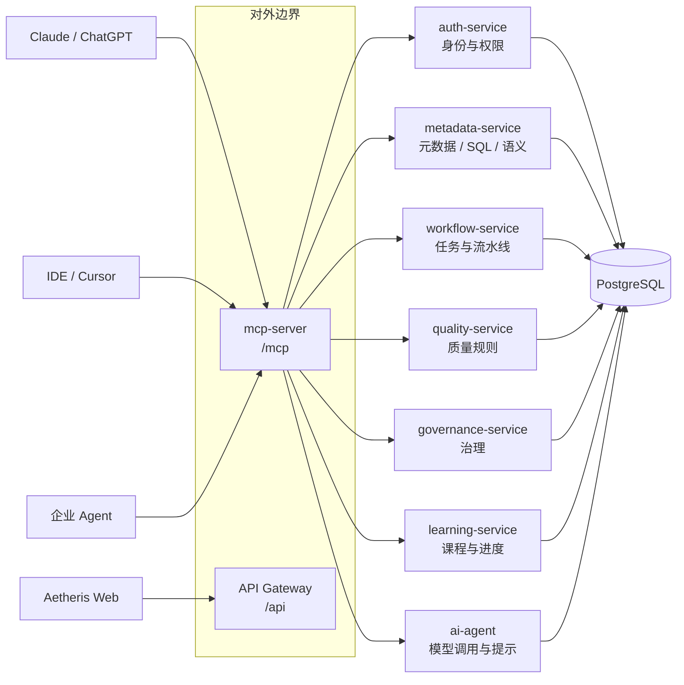

# Aetheris AI 原生能力与 MCP 暴露设计

> **注意：本文档已于 2026-11-12 整合进《[Aetheris 数据中台实训平台总体设计与开发排期](aetheris-integrated-design-and-development-plan.md)》，新文档为唯一基线，本文仅作历史存档保留。**

版本：2026-11-12 v0.1（设计稿）
定位：在现有数据平台和实训平台设计之上，增加 AI 原生智能应用层，并通过 MCP（Model Context Protocol）把平台能力开放给外部 AI 客户端、IDE、Agent 和企业工作流。

> 结论先行：Aetheris 不应该只做一个“内置聊天框”，而应该做成一个 **AI 可操作的数据平台**。现有 DataAgent 已经具备用户绑定、只读 SQL 守卫、指标优先、预算限制和审计等基础，适合演进为两层能力：**平台内智能应用** + **对外 MCP 服务器**。对外暴露建议新增独立的 `mcp-server` 服务，所有工具调用仍复用现有内部安全边界，不允许绕过权限、SQL 守卫、审计和资源配额。

---

## 1. 现状与差距

### 1.1 已有智能能力

当前 `ai-agent` 已具备：

| 能力 | 现状 | 限制 |
| --- | --- | --- |
| DataAgent 工具循环 | Spring AI `ChatClient` 驱动 `@Tool` 调用 | 只在平台内部聊天场景可用 |
| 元数据检索 | `searchTables` 支持关键词、层级过滤 | 尚未对外标准化 |
| 语义指标查询 | `searchMetrics` / `queryMetric` 优先 | 尚未对外标准化 |
| 只读 SQL | `query` 走 SQL 守卫和只读账号 | 尚未对外标准化 |
| 权限与审计 | 用户绑定、会话隔离、预算限制、审计 | 面向内部 API，不是 MCP |
| 提示词治理 | `AgentPrompts` 固化数仓纪律 | 尚未版本化管理 |
| AI 预算 | 模型调用、工具调用、token、超时、并发队列 | 尚未覆盖 MCP 客户端 |

### 1.2 主要缺口

1. **没有 MCP 服务器**：项目内没有实现 `tools/list`、`tools/call`、`resources/list`、`resources/read` 等标准能力。
2. **智能应用散落在聊天场景**：SQL 生成、治理、运维、学习辅导还没有形成独立产品能力。
3. **外部 AI 客户端无法安全接入**：IDE、Cursor、Claude、ChatGPT、企业 Agent 无法把 Aetheris 当作一个受控数据工具源。
4. **工具治理缺失**：缺少工具版本、权限声明、输入输出 schema、审计和审批流。
5. **长任务能力缺失**：数据开发、质量检查、流水线执行是长任务，需要 MCP Tasks 扩展而不是一次性同步调用。

---

## 2. AI 原生设计原则

1. **AI 是操作者，不是旁路。**  
   所有 AI 工具必须走与人类相同的权限、审计、SQL 守卫和资源配额。

2. **先读后写，先草稿后执行。**  
   查询类工具可以直接返回结果；开发、治理、发布类工具只能生成草稿或建议，实际执行必须走审批。

3. **平台内智能与 MCP 暴露共用同一套领域服务。**  
   MCP 不直接连数据库，也不复制业务逻辑，只做协议适配、鉴权、限流和工具编排。

4. **工具即产品。**  
   每个工具必须有清晰名称、描述、参数 schema、返回 schema、风险级别、权限要求和示例。

5. **可解释优先于聪明。**  
   AI 回答必须能追溯到表、字段、指标、任务、执行 ID或学习证据。

6. **模型可替换。**  
   继续沿用 `LlmClient` 端口与适配器设计，避免绑定单一厂商。

---

## 3. 智能应用功能地图

建议新增八类智能应用：

### 3.1 AI 数据导师

面向学员和小白用户：

- 解释当前任务的业务背景。
- 根据学员进度推荐下一步。
- 对错误日志做自然语言解释。
- 分级提示，不直接给完整答案。
- 生成个人复盘报告。
- 根据能力雷达推荐补弱任务。

典型场景：

> 学员执行 DWD 清洗任务失败，AI 导师读取失败日志、表结构和课程要求，指出“你过滤了逻辑删除标记，但没有处理重复订单”，并给出下一步提示。

### 3.2 智能问数

面向业务用户：

- 优先匹配已发布指标。
- 指标不存在时回退到表检索。
- 自动生成口径说明和 SQL。
- 支持图表建议和数据新鲜度说明。
- 拒绝无权限数据。

典型场景：

> 用户问“2026 年 8 月销售额最高的品类”，AI 返回数值、指标编码、版本、来源表和 SQL。

### 3.3 SQL 与数据开发副驾

面向数据开发：

- 根据表结构生成 SQL 草稿。
- 检查命名、分区条件、幂等和血缘。
- 解释慢查询。
- 生成补数和回溯任务草稿。
- 生成质量规则建议。
- 生成代码评审意见。

重要边界：**只生成草稿，不直接发布或执行写任务**。

### 3.4 数据治理副驾

面向治理人员：

- 根据字段注释和样例数据推荐分类分级。
- 识别潜在重复指标。
- 分析表下线影响。
- 生成治理问题单草稿。
- 推荐质量规则和阈值。

### 3.5 运维诊断副驾

面向运维和开发：

- 读取任务失败证据。
- 关联血缘、质量结果和执行日志。
- 给出可能原因和处置建议。
- 生成 runbook 摘要。
- 推荐下一步操作。

典型场景：

> 某天 GMV 下降，AI 读取任务运行、上游血缘、质量规则和分区数据量，指出“上游 ODS 分区缺数，导致 DWD 空分区”。

### 3.6 学习内容生成器

面向内容作者：

- 从平台能力自动生成任务卡草稿。
- 根据技能节点生成练习和验收标准。
- 生成隐藏测试集建议。
- 生成复盘问题。
- 辅助课程审校。

### 3.7 作品集与能力评审器

面向学员和招聘场景：

- 汇总项目、代码、看板、执行证据。
- 生成能力雷达。
- 输出作品集摘要。
- 对提交进行 AI 初评和人工复核建议。

### 3.8 企业 Agent 工作流

面向企业客户：

- 日报、周报自动生成。
- 指标异常检测和归因。
- 数据质量问题自动派单。
- 变更影响分析。
- 跨系统数据资产问答。

这些工作流应通过 MCP Tasks 和审批流实现，不允许 AI 自主执行高风险操作。

---

## 4. MCP 暴露设计

### 4.1 协议基线

建议以 **MCP 2026-07-28 规范**为基线：

- 使用 JSON-RPC 2.0。
- 采用无状态、自包含请求。
- 支持按请求能力协商。
- 服务端提供 Tools、Resources、Prompts。
- 网关可根据 `Mcp-Method` 和 `Mcp-Name` 头做路由和授权。
- 列表结果可带缓存提示。
- 长任务使用 Tasks 扩展。
- 需要用户补充输入时使用 Multi Round-Trip Requests。
- 可选支持 MCP Apps，用于在客户端内渲染图表、表单和学习卡片。

### 4.2 服务形态

建议新增一个独立服务：

```text
mcp-server
├── MCP 协议适配层
├── 工具注册与版本管理
├── 权限与同意管理
├── 限流与预算
├── 审计与追踪
└── 内部服务调用客户端
```

职责边界：

- 只做协议适配，不做业务逻辑。
- 不直接连接业务数据库。
- 不复制 SQL 守卫。
- 不绕过 Auth、Metadata、Workflow、Quality、Learning 等服务。
- 对外统一暴露 `/mcp`。
- 所有工具调用必须携带用户或客户端身份。

### 4.3 总体架构



### 4.4 传输与路由

- 对外使用 Streamable HTTP。
- 本地开发可提供 stdio 适配器。
- 每个请求携带：
  - `MCP-Protocol-Version`
  - `Mcp-Method`
  - `Mcp-Name`
  - `Authorization`
- 网关可根据 `Mcp-Method` 和 `Mcp-Name` 做路由、限流和审计。
- 不依赖会话状态；长任务通过持久句柄关联。

### 4.5 工具分层

| 层级 | 工具类型 | 执行方式 | 风险 |
| --- | --- | --- | --- |
| L0 | 只读查询 | 直接返回 | 低 |
| L1 | 诊断与建议 | 直接返回 | 低 |
| L2 | 草稿生成 | 生成草稿，不落生产 | 中 |
| L3 | 任务执行 | 创建审批任务 | 高 |
| L4 | 管理操作 | 默认不开放，仅白名单 | 极高 |

---

## 5. MCP Tools 设计

### 5.1 数据查询类

| 工具 | 说明 | 权限 |
| --- | --- | --- |
| `search_tables` | 按关键词和层级检索表 | `metadata.table.view` |
| `describe_table` | 读取字段、类型、注释 | `metadata.table.view` |
| `query_readonly_sql` | 执行只读 SQL | `metadata.datasource.query` |
| `search_metrics` | 检索已发布指标 | `metadata.metric.view` |
| `query_metric` | 查询语义指标 | `metadata.metric.query` |
| `get_table_profile` | 读取表统计、分区、样例摘要 | `metadata.table.view` |
| `get_lineage` | 读取表级或字段级血缘 | `metadata.lineage.view` |

示例：`search_tables`

```json
{
  "name": "search_tables",
  "description": "按关键词检索数据仓库中的表，可按数仓层级过滤。",
  "inputSchema": {
    "type": "object",
    "properties": {
      "keyword": { "type": "string" },
      "layer": { "type": "string", "enum": ["ods", "dwd", "dws", "ads", "dim"] }
    },
    "required": ["keyword"]
  },
  "annotations": {
    "readOnlyHint": true,
    "destructiveHint": false
  }
}
```

### 5.2 数据开发类

| 工具 | 说明 | 输出 |
| --- | --- | --- |
| `draft_sql` | 根据目标表和需求生成 SQL 草稿 | SQL + 说明 |
| `validate_sql` | 校验语法、守卫、分区、权限 | 通过/失败原因 |
| `explain_sql` | 解释 SQL 逻辑和执行计划 | 结构化解释 |
| `optimize_sql` | 给出优化建议 | 建议列表 |
| `create_task_draft` | 生成任务定义草稿 | 任务草稿 |
| `review_pipeline` | 审查依赖、幂等、质量门禁 | 评审意见 |

约束：以上工具不直接执行写操作。

### 5.3 治理类

| 工具 | 说明 |
| --- | --- |
| `suggest_quality_rules` | 推荐质量规则 |
| `classify_columns` | 推荐字段分类分级 |
| `analyze_impact` | 分析下线或变更影响 |
| `create_governance_issue_draft` | 生成治理问题单草稿 |
| `find_duplicate_metrics` | 识别疑似重复指标 |

### 5.4 运维诊断类

| 工具 | 说明 |
| --- | --- |
| `get_run_status` | 查询任务运行状态 |
| `get_failure_evidence` | 读取失败证据链 |
| `diagnose_execution_failure` | 生成故障诊断 |
| `get_runbook` | 获取处置手册 |
| `get_alert_summary` | 汇总告警 |

### 5.5 学习类

| 工具 | 说明 |
| --- | --- |
| `get_learning_path` | 获取学习路径与进度 |
| `get_current_lab` | 获取当前实验 |
| `request_hint` | 请求分级提示 |
| `submit_lab` | 提交作业 |
| `get_grading_feedback` | 获取评分与反馈 |
| `get_skill_radar` | 获取能力雷达 |
| `generate_retrospective` | 生成复盘报告 |

### 5.6 内容创作类

| 工具 | 说明 |
| --- | --- |
| `generate_lab_draft` | 生成实验任务草稿 |
| `generate_course_module` | 生成课程模块草稿 |
| `generate_test_set` | 生成隐藏测试集建议 |
| `review_submission_draft` | 生成作业初评意见 |

---

## 6. MCP Resources 设计

Resources 用于向 AI 提供可读上下文：

| URI | 说明 |
| --- | --- |
| `aetheris://catalog/tables/{tableId}` | 表结构与注释 |
| `aetheris://catalog/metrics/{metricCode}` | 指标定义与版本 |
| `aetheris://lineage/{tableId}` | 血缘图 |
| `aetheris://quality/rules/{ruleId}` | 质量规则 |
| `aetheris://runs/{runId}` | 任务运行证据 |
| `aetheris://learning/path/{learnerId}` | 学习路径 |
| `aetheris://learning/lab/{labId}` | 实验任务 |
| `aetheris://runbook/{incidentType}` | 运维手册 |

设计要求：

- Resource 读取同样需要权限校验。
- 大对象必须分页或摘要化。
- 返回内容必须带版本和更新时间。
- 不允许把原始凭据、密钥或隐藏测试集作为 Resource 暴露。

---

## 7. MCP Prompts 设计

Prompts 用于沉淀可复用的专家工作流：

| Prompt | 用途 |
| --- | --- |
| `sql_review` | SQL 评审 |
| `metric_definition` | 指标口径梳理 |
| `data_quality_triage` | 质量问题分诊 |
| `incident_diagnosis` | 故障诊断 |
| `learning_path_recommendation` | 学习路径推荐 |
| `lab_feedback` | 实验反馈 |
| `submission_review` | 作业评审 |

Prompt 应版本化管理，并与工具、资源和模型版本一起纳入回归测试。

---

## 8. 长任务与交互扩展

### 8.1 Tasks

适用于：

- SQL 加工任务。
- Spark / Flink 任务。
- 质量检查。
- 流水线执行。
- 作业评分。
- 报表生成。

流程：

1. AI 调用工具创建任务。
2. MCP 返回持久 `taskId`。
3. AI 轮询状态或接收完成通知。
4. 结果绑定执行 ID、数据快照和审计证据。

### 8.2 MCP Apps

适用于：

- 学习任务卡片。
- 数据看板嵌入。
- SQL diff 审查表单。
- 审批确认界面。
- 指标口径对比卡片。

### 8.3 Skills over MCP

适用于把完整工作流打包成技能，例如：

- “电商离线数仓建模”。
- “数据质量专项治理”。
- “指标口径梳理”。
- “任务故障诊断”。

---

## 9. 安全与治理设计

### 9.1 身份与授权

- 使用 OAuth 2.1 + PKCE 或企业托管授权。
- 不建第二套身份体系，复用 `auth-service`。
- 每个工具调用必须携带用户或客户端身份。
- 工具列表按权限过滤，但**权限校验必须在服务端执行**。

### 9.2 同意与审计

- 首次调用敏感工具前必须获得用户同意。
- 每次调用记录：
  - 用户
  - 客户端
  - 工具名
  - 参数摘要
  - 资源
  - 结果状态
  - 耗时
  - 关联执行 ID

### 9.3 输入校验

- 所有工具使用 JSON Schema 校验。
- 拒绝未知字段。
- SQL 类工具复用现有 SQL 守卫。
- 工具描述视为不可信输入，不能作为授权依据。

### 9.4 输出保护

- 不返回凭据、密钥、内部 IP。
- 不返回隐藏测试集。
- 不返回未脱敏 PII。
- 大结果必须截断、分页或摘要化。
- 结果中明确标注数据来源、版本和新鲜度。

### 9.5 预算与限流

- 复用 AI 预算模型。
- 按用户、租户、工具、客户端限流。
- 单次调用限制 token 和工具结果大小。
- 长任务限制并发和时长。

### 9.6 防注入

- 工具返回内容视为数据，不作为指令。
- 不允许模型修改系统提示。
- 高风险操作必须走审批，不接受“模型确认”。
- 对用户输入和工具结果做双向隔离。

---

## 10. 与现有架构的集成方式

1. **新增 `mcp-server` 服务**  
   负责协议、鉴权、工具注册和审计，不承载业务逻辑。

2. **复用现有内部服务**  
   - 元数据和 SQL：`metadata-service`
   - 任务与流水线：`workflow-service`
   - 质量规则：`quality-service`
   - 治理：`governance-service`
   - 权限：`auth-service`
   - 学习：`learning-service`
   - 模型调用：`ai-agent`

3. **复用现有安全协议**  
   - 签名 HTTP 客户端
   - 工作负载证明
   - 用户证明
   - Nonce 防重放
   - 权限版本

4. **复用现有审计体系**  
   所有 MCP 调用进入统一审计流，并可与任务运行 ID 关联。

---

## 11. 实施路线

### 阶段 1：MCP 基础能力

- 新增 `mcp-server`。
- 支持 `tools/list`、`tools/call`、`resources/list`、`resources/read`、`prompts/list`。
- 开放只读数据工具：
  - `search_tables`
  - `describe_table`
  - `query_readonly_sql`
  - `search_metrics`
  - `query_metric`
- 接入身份、权限、审计和限流。

### 阶段 2：智能开发与治理工具

- 开放 SQL 草稿、校验、解释、优化工具。
- 开放质量规则建议和影响分析工具。
- 引入审批流。
- 接入 Tasks 扩展。

### 阶段 3：学习与内容工具

- 开放学习路径、实验、提示、评分、复盘工具。
- 支持学习任务卡片。
- 支持作品集评审。

### 阶段 4：企业 Agent 工作流

- 开放日报、周报、异常归因、治理派单。
- 支持 MCP Apps。
- 支持 Skills over MCP。
- 支持企业托管授权。

---

## 12. 验收指标

| 指标 | 目标 |
| --- | --- |
| MCP 工具权限校验覆盖率 | 100% |
| 高风险工具直接执行数 | 0 |
| 工具调用审计覆盖率 | 100% |
| 只读 SQL 越权成功率 | 0 |
| 工具响应 P95 | ≤ 3 秒 |
| 长任务状态可追溯率 | 100% |
| 提示词与工具版本回归覆盖率 | ≥ 90% |
| 未授权资源暴露数 | 0 |

---

## 13. 主要风险

| 风险 | 应对 |
| --- | --- |
| MCP 暴露扩大攻击面 | 独立服务、最小权限、服务端校验、审计 |
| 工具被滥用 | 限流、预算、审批、黑名单 |
| 模型幻觉 | 强制引用来源、工具结果与模型回答分离 |
| 提示注入 | 输入输出隔离、不可信内容标记、系统提示不可变 |
| 长任务超时 | Tasks 扩展、持久句柄、异步状态查询 |
| 权限模型复杂 | 按工具声明最小权限，服务端统一鉴权 |
| 协议演进 | 固定协议版本、兼容测试、灰度发布 |

---

## 14. 待确认问题

1. 第一版 MCP 面向个人开发者、企业客户还是两者同时开放？
2. 是否需要支持 stdio 传输？
3. 是否优先接入 Claude、ChatGPT、Cursor 还是企业自建 Agent？
4. 企业客户是否需要独立部署 MCP Server？
5. 高风险操作是否全部走平台审批，还是允许管理员配置白名单？
6. 是否需要把 MCP 调用纳入计费体系？
7. 是否需要支持 MCP Apps 的完整 UI 能力，还是先只做文本和结构化结果？

---

## 15. 总结

Aetheris 应该从“带 AI 聊天的数据平台”升级为“AI 可操作的数据平台”：

1. 平台内提供 AI 导师、智能问数、开发副驾、治理副驾和运维诊断。
2. 对外通过 MCP 暴露标准化工具、资源和提示词。
3. 所有能力都建立在现有权限、审计、SQL 守卫和预算体系之上。
4. 高风险操作一律草稿化、审批化，不允许 AI 直接越权执行。

这样既能服务小白学员，也能服务企业 AI Agent 生态，形成真正的 AI 原生数据平台。
