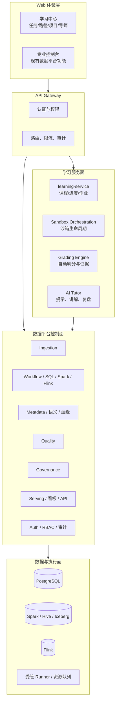
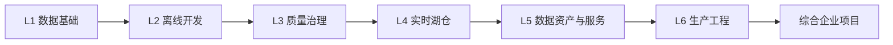

# Aetheris 数据中台实训平台可行性分析与系统设计

> **注意：本文档已于 2026-11-12 整合进《[Aetheris 数据中台实训平台总体设计与开发排期](aetheris-integrated-design-and-development-plan.md)》，新文档为唯一基线，本文仅作历史存档保留。**

版本：2026-11-12 v0.1（设计稿）
定位：在现有 Aetheris 数据平台之上，增加“数据开发全流程实训”能力，形成“工业级数据中台 + 干中学教学系统”的双平面产品。

> 结论先行：**技术上高度可行，产品上具备明显差异化，但不是在现有平台上补几个课程页面就能完成。** 现有项目的控制面、数仓底座、执行审计、安全边界和测试证据体系已经超过普通原型，足以作为“真实企业环境”的教学底座；真正的缺口是四个全新系统：学习路径与课程系统、学员沙箱与资源隔离系统、自动评测与证据系统、AI 导师与复盘系统。若沿用现有工程纪律，3-5 人团队可在 6-9 个月交付可商用的实训 MVP；达到企业级 GA 仍需按既有企业交付路线图补齐生产闭环。

---

## 1. 现状盘点：可复用资产与真实缺口

### 1.1 已经具备的能力

| 领域 | 当前能力 | 教学价值 |
| --- | --- | --- |
| 平台架构 | Gateway + 9 个业务服务 + Web 控制台，PostgreSQL、Redis、Prometheus、Docker Compose | 学员可以直接在真实微服务架构中学习，而不是看模拟页面 |
| 数据接入 | 数据源管理、批量接入、调度、执行记录、失败待办 | 可设计“从业务库到平台”的接入实验 |
| 数据开发 | SQL 任务、受管 Spark、Flink 控制面、混合 DAG、Quartz 集群调度、断点续跑 | 覆盖离线开发、实时开发和调度运维主线 |
| 数仓底座 | ODS/DWD/DWS/ADS/DIM 五层，约 130 万订单、320 万明细、180 个分区，11 类真实脏数据 | 是“数据清洗、分层建模、口径治理”的天然教材 |
| 数据质量 | 非空、范围、枚举、重复、自定义 SQL 规则，结果留痕 | 可把质量从概念课变成可执行、可评分的任务 |
| 元数据与血缘 | 表级/字段级血缘、语义依赖、影响分析 | 可训练影响分析、变更评估等高阶能力 |
| 语义层 | 业务域、逻辑模型、语义维度、指标版本与发布生命周期 | 可教学 OneData、指标口径治理、版本治理 |
| 数据服务与消费 | 数据集、看板、指标查询、API 资产、订阅授权 | 可训练“数据资产到业务消费”的完整链路 |
| 智能中心 | DataAgent、智能问数、只读 SQL 防护 | 可作为 AI 导师和智能评测的基础 |
| 权限与安全 | RBAC、资源授权、数据范围、权限版本、SQL 双守卫、审计 | 可教学企业数据安全与权限治理 |
| 工程治理 | 123 份左右 Flyway 迁移、大量单测/契约/验收脚本、成熟度分级、证据链 | 可训练工程规范、验收思维和可追溯交付 |

### 1.2 当前主要缺口

1. **学习系统缺口**：代码和导航中没有课程、学习路径、实验、作业、评分、证书、学习进度等能力。
2. **学员隔离缺口**：当前权限模型面向企业用户，尚缺少面向大量学员的沙箱生命周期、资源配额、数据集快照和自动回收。
3. **自动评测缺口**：现有质量规则和执行审计可以复用，但缺少“面向学习目标”的判分器、隐藏测试集、评分细则和成长报告。
4. **教学内容缺口**：现有文档是工程文档，不是面向小白的课程；需要把平台能力重构为任务卡、企业需求工单、故障演练和项目制学习。
5. **产品形态缺口**：当前 UI 是专业控制台，小白用户会被菜单和数据平台术语劝退；需要“学习模式”作为第一入口。
6. **生产成熟度缺口**：项目自身文档明确企业 GA 尚未完成，包括安装升级、灾备、租户隔离、真实引擎验收、可观测和容量证明等。

---

## 2. 目标定义

### 2.1 产品目标

建设一个“真实企业数据中台之上的实训平台”：

1. 学员通过完成企业真实任务学习数据开发全流程。
2. 每个知识点都对应平台上的真实操作、真实数据和真实执行结果。
3. 系统自动判定结果、给出反馈、沉淀证据，形成可展示的能力档案。
4. 教学环境与工业级平台共用同一套控制面和安全边界，避免“培训版玩具”和“生产版系统”两张皮。
5. 面向个人学习、高校实训、企业内训和求职作品集四类场景。

### 2.2 非目标

以下事项不纳入第一版，避免范围失控：

- 不做通用在线课程平台，不追求视频课数量。
- 不做自由多 Agent 市场。
- 不承诺学员完成课程即达到“大厂资深工程师”水平；目标应定义为“达到初中级数据开发岗位的可独立工作水平”。
- 不在第一版实现完整企业 GA、Kubernetes 生产化、多租户 SaaS 和商业化计费。
- 不允许教学沙箱访问真实生产数据或客户数据。

### 2.3 学习成果定义

建议把“企业大厂开发水平”拆成可验证的能力等级：

| 等级 | 目标能力 | 建议学习量 |
| --- | --- | --- |
| L1 数据基础 | SQL、数据源、表结构、基础查询 | 20-30 小时 |
| L2 离线开发 | ODS/DWD/DWS/ADS 建模、清洗、调度任务 | 60-80 小时 |
| L3 质量治理 | 质量规则、血缘、标准、问题闭环 | 30-40 小时 |
| L4 实时与湖仓 | Flink、CDC、Iceberg、流批任务 | 60-80 小时 |
| L5 数据资产与服务 | 指标、语义层、看板、API、订阅 | 30-40 小时 |
| L6 生产工程 | 权限、审计、故障排查、成本、发布 | 40-60 小时 |
| 综合项目 | 2 个端到端企业项目作品 | 60-100 小时 |

完成 L1-L6 和综合项目后，学员应能独立承担初中级数据开发岗位的核心任务，并拥有可验证的项目证据。是否达到“大厂水平”还取决于业务复杂度、沟通能力和长期实践，不应作为系统承诺。

---

## 3. 可行性分析

### 3.1 技术可行性：高

**有利条件：**

- 现有平台已经有真实数据、真实执行、真实权限、真实审计，而非静态演示。
- SQL 守卫、写入守卫、只读账号、资源授权、数据范围和审计体系可以直接保护学员操作。
- 五层数仓和 11 类脏数据天然适合任务化教学。
- 受管 Spark、Flink 控制面、质量规则、血缘和语义层覆盖了数据开发核心知识面。
- 现有测试和验收脚本可以扩展为自动判分器。

**主要技术难点：**

1. **学员沙箱资源隔离**：大量学员同时执行 Spark/Flink 任务会带来资源、成本和噪声问题。
2. **学习数据集版本管理**：同一实验需要可重复初始化、可重跑、可校验。
3. **判分的确定性**：SQL、任务 DAG、质量结果、性能指标和主观题需要不同判分策略。
4. **小白可用性**：专业控制台信息密度过高，需要学习模式、任务向导和术语解释。
5. **AI 导师可控性**：不能直接代替学员完成作业，也不能编造平台能力或数据口径。

### 3.2 产品可行性：高，但必须重新设计入口

现有产品是“给数据工程师用的平台”，目标用户是“不会数据开发的小白”。这不是功能差距，而是产品形态差距。

建议采用双模式：

- **学习模式**：以任务、关卡、项目、导师反馈为主线，逐步解锁专业功能。
- **专业模式**：保持现有控制台，供有经验用户和企业用户使用。

学习模式不是隐藏菜单，而是新的第一入口。小白进入后看到的不是“数据源管理、元数据、血缘”，而是“任务：把订单库接入平台并清洗出有效订单”。

### 3.3 内容可行性：中，是最大瓶颈

技术系统可以复用，但课程内容必须重新生产：

- 每个知识点需要概念解释、示例、任务、验收标准、常见错误和进阶挑战。
- 每个任务需要初始数据、期望结果、隐藏测试集、判分规则和复盘报告。
- 高阶任务需要真实故障演练、性能优化和企业需求文档。

现有项目文档可以提供高质量素材，但需要课程化改写。没有专职内容作者或资深数据开发教育者参与，课程质量会成为最大风险。

### 3.4 资源与成本可行性：中高

| 成本项 | 判断 |
| --- | --- |
| 开发人力 | 3-5 人团队可完成 MVP；单人可行但周期显著拉长 |
| 计算资源 | 小规模 SQL 实验成本低；Spark/Flink 实验需要配额、队列和冷启动策略 |
| 内容生产 | 主要成本，需要持续投入 |
| AI 成本 | AI 导师和智能判分需要 token 预算，必须复用现有预算与限流机制 |
| 运维成本 | 教学环境需要自动清理、快照恢复和批量部署 |

### 3.5 时间可行性

按企业交付路线图，若目标是完整企业 GA，3-5 人团队约 8-12 个月，单人 12-20 个月。若目标是实训 MVP，可以在不等待全部企业 GA 的情况下先行交付：

1. **先完成可靠基线**：关闭现有 W0-W6 中影响稳定性的必要问题，约 1-2 个月。
2. **实训 MVP**：学习中心、沙箱、SQL/数仓路径、自动判分、AI 导师基础，约 3-4 个月。
3. **扩展版**：实时、湖仓、治理、数据服务和企业项目，约 3-5 个月。
4. **商业化/企业级版本**：多租户、K8s、计费、证书体系，约 3-6 个月。

因此，MVP 总体可在 6 个月后进入真实学员试用，完整实训平台约 12 个月。

---

## 4. 目标系统设计

### 4.1 总体架构：控制面与学习面双平面



设计原则：

1. **不复制平台能力**：学习服务只管理教学域，不复制数据源、SQL 执行、调度和权限。
2. **所有学员操作走既有安全边界**：SQL 守卫、权限版本、资源授权、审计继续生效。
3. **教学数据与生产数据隔离**：教学数据集使用独立 workspace、独立数据源和独立配额。
4. **学习证据绑定真实执行**：每个作业结果关联任务 ID、执行 ID、数据快照和判分证据。
5. **AI 只做导师，不做代写**：AI 可以解释、提示和复盘，但默认不能直接给出可提交答案。

### 4.2 核心子系统

#### 4.2.1 learning-service：课程与学习域

建议新增一个独立 Spring Boot 服务，负责：

- 课程、模块、任务、项目、技能节点管理。
- 学员注册、学习路径、进度、解锁规则。
- 作业提交、重做、延期、申诉。
- 证书、作品集、能力雷达。
- 与内容作者后台的版本管理和审核流。

不建议把课程系统拆成多个微服务。学习域生命周期独立，但业务复杂度集中，第一版用一个服务更利于演进。

#### 4.2.2 Sandbox Orchestration：学员沙箱

负责为每个学员/实验创建隔离环境：

- 创建学员 workspace、角色、数据源凭据、默认配额。
- 初始化教学数据集和业务日期窗口。
- 绑定可用的计算资源队列。
- 实验结束后归档结果、清理临时表和回收资源。
- 提供快照/重置，保证实验可重复。

推荐分三档实现：

| 档位 | 适用任务 | 隔离方式 |
| --- | --- | --- |
| Light | SQL、元数据、质量规则、看板 | 共享数据库 + schema/前缀隔离 + 权限隔离 |
| Medium | Spark 批处理、混合 DAG | 共享引擎 + 独立队列 + 表命名空间 + CPU/内存配额 |
| Heavy | Flink、CDC、Iceberg 维护、性能实验 | 独立容器/命名空间 + 冷启动池 + 限时回收 |

第一版优先 Light 和 Medium，Heavy 课程作为付费或企业版能力。

#### 4.2.3 Grading Engine：自动判分与证据

判分器是教学质量的核心，建议分为五层：

1. **静态判分**
   - SQL 语法、AST 白名单、危险语句拦截。
   - 命名规范、分区条件、注释和口径说明。
   - DAG 结构、依赖正确性、幂等设计。
2. **动态判分**
   - 在隐藏验证数据集上执行学员产物。
   - 比较行数、checksum、schema、指标值、分区结果。
   - 校验质量规则命中数和脏数据处理结果。
3. **过程判分**
   - 任务是否按企业流程执行：先看元数据、再建模、再开发、再测试、再发布。
   - 是否产生必要的血缘、质量结果和审计记录。
4. **性能与成本判分**
   - 执行耗时、扫描量、分区裁剪、资源占用。
   - 用于性能优化课程，不作为所有任务的硬门槛。
5. **主观与表达判分**
   - 方案说明、口径解释、复盘报告。
   - AI 初评 + 人工复核 + 抽样校准。

每个评分项必须输出：

- 分数与等级。
- 通过/失败原因。
- 参考答案提示是否解锁。
- 关联的执行 ID、数据快照、规则版本和审计证据。

#### 4.2.4 AI Tutor：AI 导师

基于现有 ai-agent 的端口与工具调用机制扩展，但不直接复用 DataAgent 的自由问数入口。建议新增教学专用工具：

| 工具 | 作用 | 约束 |
| --- | --- | --- |
| getLesson | 读取当前任务的知识点 | 只返回与进度匹配的内容 |
| inspectSubmission | 读取学员提交摘要和执行结果 | 不暴露隐藏测试集 |
| getRubric | 读取评分标准 | 明确展示扣分原因 |
| getHint | 按等级给出提示 | 逐级提示，不直接给完整答案 |
| explainError | 解释执行错误 | 只基于真实日志和错误码 |
| generateReview | 生成复盘建议 | 必须引用任务、执行和评分证据 |

AI 导师需要三类防护：

- **教学防护**：提示分级，禁止默认输出完整可提交答案。
- **事实防护**：只能基于平台元数据、课程内容和执行结果回答，不得编造表结构或口径。
- **权限防护**：不得读取隐藏测试集、其他学员数据或未授权生产数据。

#### 4.2.5 AI 原生扩展与 MCP 暴露

除平台内 AI 导师外，Aetheris 还应升级为“AI 可操作的数据平台”：

- 内置智能应用：智能问数、SQL 开发副驾、治理副驾、运维诊断、学习内容生成、作品集评审。
- 对外暴露 MCP 服务器，让 Claude、ChatGPT、Cursor、企业 Agent 和 IDE 可以把 Aetheris 作为受控工具源。
- 新增独立 `mcp-server` 服务，只做协议适配和鉴权，不复制业务逻辑。
- 所有工具调用复用现有权限、SQL 守卫、审计、预算和审批边界。
- 高风险操作只生成草稿或审批任务，不允许 AI 直接执行。

详细设计见：[AI 原生能力与 MCP 暴露设计](ai-native-mcp-extension-design.md)。

### 4.3 学习模式产品设计

小白进入系统后不应先看到专业菜单，而应进入学习工作台：

```text
我的学习路径
├── 当前任务：清洗订单 ODS 并生成 DWD 有效订单
│   ├── 1. 阅读业务需求卡
│   ├── 2. 查看数据源和表结构
│   ├── 3. 编写清洗 SQL
│   ├── 4. 运行任务并查看结果
│   ├── 5. 配置质量规则
│   ├── 6. 提交作业
│   └── 7. 查看评分与复盘
├── 下一个任务
├── 我的技能雷达
└── 导师会话
```

关键体验设计：

- **任务卡片**：每个任务包含背景、目标、输入、输出、验收标准和提示。
- **企业工单化**：把知识点包装成业务需求、故障工单或优化需求。
- **渐进解锁**：完成基础任务后才开放实时开发、湖仓维护等高阶功能。
- **失败即教学**：错误日志、质量失败、调度失败都转化为可解释的学习材料。
- **作品集**：自动沉淀学员的项目、代码、看板、指标和执行证据。
- **双模式切换**：学员可随时查看专业控制台，理解企业平台的真实界面。

### 4.4 学习路径设计



#### L1 数据基础

- SQL 基础与查询安全。
- 数据源连接与元数据浏览。
- 表结构、字段注释、分区概念。
- 数据质量问题的第一印象：空值、重复、非法枚举。

#### L2 离线开发

- ODS 到 DWD 的清洗策略。
- 维度建模与 DIM/DWS/ADS 分层。
- 动态分区、幂等重跑、补数据。
- Quartz 调度、依赖拓扑、失败重试。

#### L3 质量治理

- 质量规则设计。
- 脏数据识别与处理。
- 血缘与影响分析。
- 数据标准、分类分级和治理问题闭环。

#### L4 实时湖仓

- CDC 概念与全量/增量同步。
- Flink SQL 与流任务生命周期。
- Iceberg 表、快照、分支与维护。
- 批流口径一致性与数据新鲜度。

#### L5 数据资产与服务

- 业务域与逻辑模型。
- 指标定义、口径、版本发布。
- 数据集、看板和数据 API。
- 订阅、授权、服务监控。

#### L6 生产工程

- 权限模型与数据范围。
- 审计、告警和故障排查。
- 成本、容量和资源配额。
- 发布、回滚、备份与恢复意识。

#### 综合企业项目

- 项目一：电商离线数仓从 0 到 1。
- 项目二：实时订单风控/经营看板。
- 项目三：数据治理专项改造。
- 每个项目要求输出方案文档、代码、任务、质量规则、看板和复盘报告。

### 4.5 核心领域模型

| 实体 | 关键字段 | 说明 |
| --- | --- | --- |
| learner | user_id, level, goal, timezone | 学员画像，关联 auth 用户 |
| learning_path | code, version, target_role | 学习路径版本 |
| skill_node | code, parent, knowledge_points, outcome | 技能树节点 |
| course | title, version, status, author | 课程，可包含多个模块 |
| module | course_id, order, objectives | 课程模块 |
| lab | module_id, difficulty, task_type, data_template | 实验任务 |
| project | scenario, deliverables, rubric | 综合项目 |
| sandbox_instance | learner_id, lab_id, environment, quota, status, expires_at | 学员沙箱 |
| submission | lab_id, learner_id, artifact_type, content, attempt | 学员提交 |
| execution_evidence | submission_id, run_id, task_id, snapshot_id | 关联真实执行证据 |
| grading_result | submission_id, score, level, details, reviewer | 自动/人工评分 |
| progress | learner_id, skill_node_id, status, score | 学习进度 |
| credential | learner_id, type, issued_at, evidence_ids | 证书与能力证明 |
| ai_tutor_session | learner_id, lab_id, token_usage, summary | AI 导师会话 |
| content_review | content_id, reviewer, status, comments | 内容审核 |

关键约束：

- 课程内容必须版本化，历史提交绑定当时的课程版本。
- 评分结果不可变，只允许追加申诉和复核记录。
- 沙箱必须有生命周期和自动回收。
- AI 会话必须记录 token、模型版本和工具调用，便于成本与质量审计。

### 4.6 API 设计概要

学习面新增 API：

- `GET /api/learning/paths`
- `GET /api/learning/paths/{id}/progress`
- `POST /api/learning/labs/{id}/start`
- `POST /api/learning/labs/{id}/submit`
- `GET /api/learning/submissions/{id}/result`
- `POST /api/learning/submissions/{id}/appeal`
- `POST /api/learning/projects/{id}/deliver`
- `GET /api/learning/credentials`
- `POST /api/learning/tutor/messages`
- `GET /api/admin/learning/contents`
- `POST /api/admin/learning/contents/{id}/publish`

所有 API 必须延续现有网关鉴权、限流、审计和错误契约。

### 4.7 安全与治理设计

1. **教学与生产隔离**
   - 教学数据集使用独立数据源和 workspace。
   - 学员角色默认无生产资源权限。
   - 教学任务只允许访问课程绑定数据集。
2. **操作边界**
   - 继续使用只读/写入 SQL 双守卫。
   - 学员不能执行 DROP、TRUNCATE、ALTER、GRANT。
   - 高风险操作仅作为“观察式课程”，由系统演示或教师操作。
3. **资源治理**
   - 学员级 CPU、内存、并发、执行时长和 AI token 配额。
   - 超限任务自动终止并转化为教学提示。
4. **数据保护**
   - 教学数据使用合成数据，不使用真实 PII。
   - AI 导师不得跨学员读取上下文。
5. **反作弊**
   - 隐藏测试集不进入前端和普通 API。
   - 记录提交时间、执行轨迹和代码相似度。
   - 证书发放前抽样式人工复核。
6. **审计**
   - 学习行为、评分、AI 调用和资源使用全部留痕。
   - 申诉与复核记录不可删除。

---

## 5. 实施路线图

### 阶段 0：稳定可靠基线（1-2 个月）

目标：不要在不稳定底座上叠加教学系统。

- 完成现有 W0-W6 中影响基本稳定性的必要项。
- 优先关闭跨账号缓存、权限分页、Flink 生命周期、湖仓授权和发布门禁等关键问题。
- 明确教学环境使用的最小稳定版本。
- 建立教学数据集的初始化脚本和验收脚本。

### 阶段 1：实训 MVP（3-4 个月）

范围：

- learning-service 第一版。
- 学习工作台、任务卡片、学习路径。
- Light 沙箱：schema 隔离、数据集初始化、自动回收。
- 自动判分：SQL 结果、质量规则、任务执行。
- L1 和 L2 学习路径，约 40-60 个任务。
- AI 导师基础：知识点讲解、错误解释、提示分级。
- 学习进度、能力雷达、作品集初版。

验收：

- 小白学员可以在无人工协助下完成 L1-L2。
- 90% 以上任务可自动判分。
- 沙箱创建小于 2 分钟，判分小于 30 秒。
- 每个评分结果都能追溯到真实执行证据。

### 阶段 2：全流程扩展（3-5 个月）

范围：

- L3-L6 学习路径。
- Medium 沙箱：Spark 批处理、混合 DAG、资源配额。
- 实时与湖仓课程。
- 数据服务、指标、看板项目。
- AI 复盘报告和代码评审。
- 教师后台、内容审核、作业申诉。

验收：

- 覆盖数据开发全流程主要技能。
- 至少 2 个端到端企业项目。
- 支持 500-1000 名学员同时在线学习的资源模型。

### 阶段 3：企业级与商业化（3-6 个月）

范围：

- 多租户和企业内训组织。
- Kubernetes 部署、弹性伸缩和成本核算。
- 证书体系、企业招聘合作或内训报告。
- 课程市场或内容作者生态。
- 完整 SLO、备份、灾备和客户支持。

验收：

- 达到企业级交付门槛。
- 支持企业客户独立部署或 SaaS 试用。
- 教学效果有可量化数据支撑。

---

## 6. 成功指标

### 6.1 学习效果指标

| 指标 | MVP 目标 |
| --- | --- |
| L1-L2 完成率 | ≥ 50% |
| 任务自动判分覆盖率 | ≥ 90% |
| 判分结果与专家复核一致率 | ≥ 85% |
| 小白无人工协助完成率 | ≥ 70% |
| 学员 NPS | ≥ 40 |
| 作品集完成率 | ≥ 40% |

### 6.2 平台技术指标

| 指标 | 目标 |
| --- | --- |
| 学习工作台可用性 | ≥ 99.5% |
| Light 沙箱创建时间 P95 | ≤ 2 分钟 |
| 自动判分 P95 | ≤ 30 秒 |
| 学员并发支持 | MVP 100 人，扩展版 1000 人 |
| AI 导师预算超限失败率 | ≤ 1% |
| 教学任务资源超卖 | 0 |

### 6.3 商业指标

- 付费转化率。
- 企业内训续约率。
- 学员就业/转岗率。
- 内容生产成本与课程生命周期。
- 单学员计算与 AI 成本。

---

## 7. 主要风险与应对

| 风险 | 等级 | 应对 |
| --- | --- | --- |
| 课程内容质量不足 | 高 | 引入资深数据开发教育者；内容版本化、专家评审、学员反馈迭代 |
| 沙箱资源成本失控 | 高 | 分级沙箱、配额、冷启动池、自动回收、按课程限制重跑次数 |
| 小白被平台复杂度劝退 | 高 | 学习模式优先；任务向导；术语卡片；渐进解锁 |
| 自动判分误判 | 中 | 隐藏测试集 + 多层判分 + 申诉机制 + 人工抽检 |
| AI 导师给出错误答案 | 中 | 只基于课程和执行证据回答；提示分级；固定评测集回归 |
| 教学功能污染生产控制面 | 中 | 学习服务独立；教学 workspace 隔离；不复制平台能力 |
| 现有企业 GA 缺口被掩盖 | 中 | 实训版本与企业版本能力边界分开标注，不宣称未验证能力 |
| 证书可信度不足 | 中 | 证据链 + 项目作品集 + 人工复核 + 企业合作背书 |
| 单人交付周期过长 | 高 | 优先 MVP，避免一次性追求完整企业级 |

---

## 8. 关键决策建议

1. **先做学习模式，不做通用课程平台。**
   核心竞争力是“真实企业数据平台上的干中学”，不是视频和题库。

2. **新增独立 learning-service，不把学习逻辑塞进现有服务。**
   课程、进度、评分和证书是独立生命周期，混入 metadata/workflow 会破坏现有领域边界。

3. **第一版只做 Light/Medium 沙箱。**
   Flink 和 Iceberg 高成本实验放第二阶段，避免资源成本压垮 MVP。

4. **自动判分优先于 AI 导师。**
   教学可信度来自可验证结果，AI 是解释和陪伴层，不是评分核心。

5. **课程内容必须版本化并绑定执行证据。**
   否则平台演进后，历史作业无法复现，证书可信度会崩塌。

6. **明确“大厂水平”的能力定义。**
   避免营销承诺过高，导致学员期望失控。目标应定义为可验证的岗位能力，而不是资历保证。

---

## 9. 待确认问题

1. 目标用户优先级是个人学员、高校、企业内训还是招聘机构？
2. 第一版是否收费？是否需要免费体验路径？
3. 是否需要对接外部 LMS、企业 SSO 或学历系统？
4. 证书是否需要第三方认证或企业合作背书？
5. 教学环境部署在公有云、私有云还是支持离线安装？
6. 课程内容由内部团队生产，还是引入外部讲师和企业导师？
7. Heavy 沙箱的预算上限和单学员成本红线是多少？
8. 是否允许企业客户导入自己的脱敏数据用于内训？

---

## 10. 总结

Aetheris 已经具备成为“工业级数据中台实训底座”的核心条件：真实数据、真实执行、真实权限、真实治理、真实审计。这不是常见的模拟教学系统可以比拟的起点。

但要实现“小白通过干中学达到企业开发水平”，还需要建设完整的学习平面：任务化课程、学员沙箱、自动判分、AI 导师、能力档案和企业项目。技术可行性高，主要瓶颈在内容生产、资源隔离和学习体验设计。

建议路线：

1. 先完成现有可靠基线。
2. 用 3-4 个月交付 L1-L2 实训 MVP。
3. 再扩展实时、湖仓、治理、数据服务和综合项目。
4. 最后推进企业级多租户和商业化。

只要坚持“真实执行 + 可验证证据 + 渐进式学习”的原则，这个项目有机会成为同时具备工程价值和教学价值的产品。
